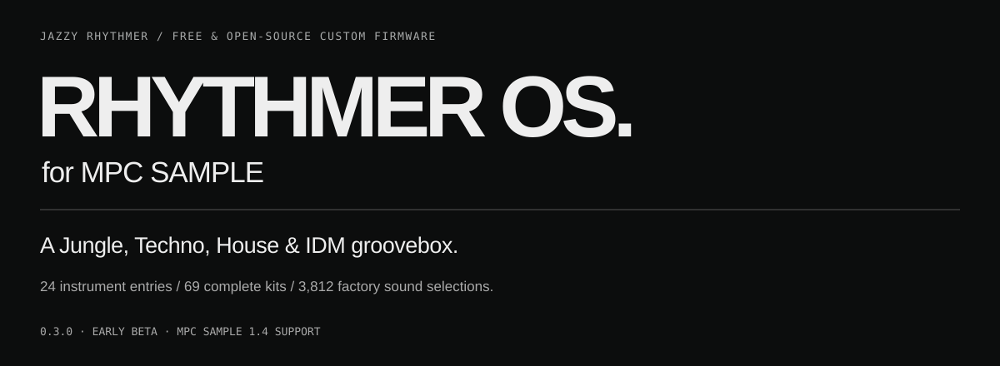

Turn your MPC Sample into an exploratory groovebox: diverse synth engines, hands-on drums, chopped breaks and new ways to find a pattern.

**[DOWNLOAD & INSTALL](https://jazzyrhythmer.github.io/mpc-sample/installer/)** · **[FIRST GROOVE GUIDE](https://jazzyrhythmer.github.io/mpc-sample/manual/quickstart.html)** · **[READ THE MANUAL](https://jazzyrhythmer.github.io/mpc-sample/manual/)** · **[WEBSITE](https://jazzyrhythmer.github.io/mpc-sample/)**

**RHYTHMER OS 0.3.0** — free and open-source custom firmware by **jazzy rhythmer**, built on **Melodee v0.8.2 by Kerem Kiliç (Ellic Studio)** and the work of the original engine authors.

## RHYTHMER OS 0.3.0

**24 engine entries · 69 complete kits · MPC Sample 1.4 support.**

[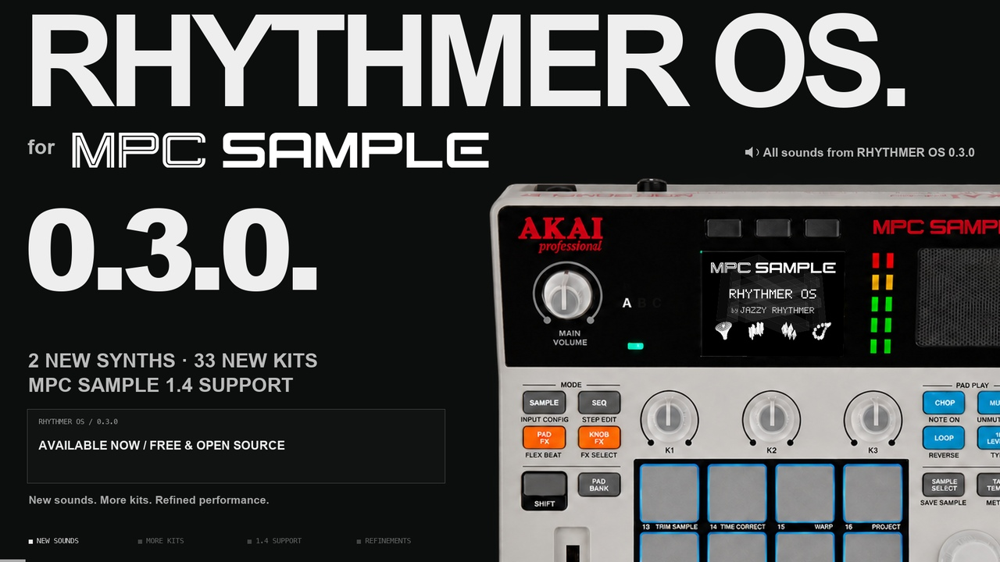](https://jazzyrhythmer.github.io/mpc-sample/#update-030)

Amino adds wavetable synthesis with 324 original presets. Fizzik adds physical-modeling synthesis with 31 original presets. There are 33 new kits: 32 from Weird Dreams’ original banks and one 16-voice KrautDrums kit.

Break PERF held effects, A/B switching and Return are refined, alongside parameter groups, track switching, GEN/Acid/Break navigation and save/recovery fixes. Supports stock firmware **1.3.0.12, 1.4.0.7 and 1.4.0.8**; an official firmware update is not required.

Use the **full SD package** so the application, plug-ins and catalogue match. On stock 1.4, enable Developer Mode before a direct installation. If using a boot manager, preserve its launcher and follow its version-specific instructions.

[Download & installation](https://jazzyrhythmer.github.io/mpc-sample/installer/) · [Current manual](https://jazzyrhythmer.github.io/mpc-sample/manual/) · [Release files](https://github.com/JazzyRhythmer/mpc-sample-rhythmer-os/releases/tag/v0.3.0)

Early beta. Software checks have passed; physical-device installation of this release has not been verified.

## Your first groove with RHYTHMER OS.

**Watch the groove, then follow the current written guide.** Follow drums, bass, FM-106 chords, an acid phrase and a chopped Think break from the first sound to a finished four-bar groove. Shape the sounds, balance the tracks and turn the loop into a mute jam.

**[▶ WATCH THE FILM](https://jazzyrhythmer.github.io/mpc-sample/#first-groove)** &nbsp; · &nbsp; **[FOLLOW THE UPDATED GUIDE ↗](https://jazzyrhythmer.github.io/mpc-sample/manual/quickstart.html)** &nbsp; · &nbsp; [DOWNLOAD THE VIDEO ↗](https://github.com/jazzyrhythmer/mpc-sample-rhythmer-os/releases/download/v0.4.0-beta.3-r2/RHYTHMER-Your-First-Groove-YouTube-v4.mp4)

*4 bars · 140 BPM · C minor. The video uses earlier screens; follow the updated 0.3.0 guide for current menu names and controls.*

## Explore the engines

Twenty-four instrument entries, 69 complete Rhythmer Kits and 3,812 factory sound selections across 31 source views (including kit voices and shared Acid selections). The descriptions below follow the [website’s engine collection](https://jazzyrhythmer.github.io/mpc-sample/#engines), with synthesis identities checked against the credited original projects. The descriptions focus on the sound engines and controls available in the MPC Sample ports.

Individual instruments concentrate on **one selected sound per track**, played chromatically or in scale. **Rhythmer Kit** brings independently assigned sounds together on sixteen pads. The native **Sample Kit** remains a separate sampler choice.

### Rhythmer Kit

**A complete drum instrument, built from different engines.**

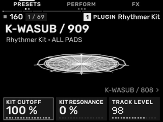

The kit combines sixteen independently assigned sounds on one track. Start with one of 69 complete kit presets, then replace a single pad’s source without rebuilding the other fifteen sounds. The palette draws from DRUM-X, Sophie, Elixir, Hortator, K-WASUB drums and the classic drum packages.

Each pad exposes its source’s sound controls. A separate whole-kit LP/BP/HP filter shapes the combined output, while User Kit presets preserve the pad assignments, edits and kit filter.

**Try it for:** Complete drum parts, hybrid electronic/acoustic-feeling kits, and changing the character of a groove while keeping its rhythm.

### Acid Engine

**Hortator ACID and Aphex voices, with a dedicated bassline generator.**

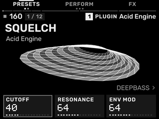

Choose from 12 original presets: four Hortator ACID sounds and eight Aphex sounds — Acid Squelch, Lead Scream, Whistle Lead, Resonant Spike, Acid Seq, Reso Bass, Filter Cry and Techno Pulse. Each selection uses its original DSP and matching filter, envelope, modulation and sound-design controls. Shape a rounded bassline, a resonant lead or a sharper, more driven phrase.

The dedicated Acid Generator creates notes, accents, slides and sustained ties; mutation varies the line. Its density, accent, slide, octave and auto-mutation settings are separate from the sound itself. The random state is internal; there is no Acid SEED knob.

**Try it for:** Acid techno, house basslines, animated ostinatos and moving filter phrases.

### Break Engine

**Turn your own loop into a playable break.**

Load a one-, two-, three- or four-bar source and declare its length. The whole loop is split into sixteen equal regions and synchronized to the project tempo. Straight, genre, random, mutate and tail-fill operations create different slice arrangements.

The six-page BRK PERF interface adds held rolls, pitch Up/Down, shrinking/building/stretching, A/B source switching and Return. Performance commands can be recorded into the sequence. Bring your own permitted loop and explore its sixteen equal divisions.

**Try it for:** Jungle, chopped breaks, rhythmic fills and live rearrangement. No break recordings are bundled.

### Sophie

**Percussion with metal, feedback and a sculpted tail.**

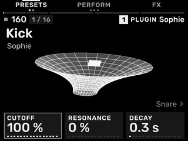

Choose an individual drum sound, then push it toward a tighter hit, a noisier snap or a more metallic ring. Sound-model, tune, color, metal, feedback, sweep, decay, crush and drive controls expose the character of the source instrument.

As an individual engine it plays one selected voice across the track’s note layout. Inside Rhythmer Kit, different Sophie voices can occupy separate pads and be edited independently.

**Try it for:** Character kicks and snares, metallic accents, synthetic hats and tightly shaped percussion.

### Elixir

**LXR-derived percussion with a wide tonal range.**

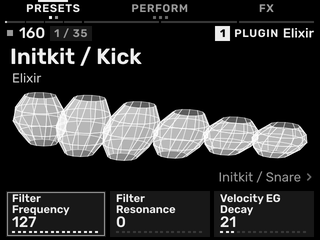

Oscillator, FM, pitch modulation, filters and envelopes let a voice move between solid drum fundamentals and more complex resonant or noisy sounds. The source palette also includes modal, Plaits-related and noise-oriented material.

The release keeps the engine Init state and the identified Rhythmer-authored Dry Circuit, Warm Machine, Bright Logic and Soft Pulse material. External Erica/Hrtl factory banks are excluded. Load one voice as an individual instrument, or combine voices in Rhythmer Kit.

**Try it for:** Electronic kicks, tuned percussion, hats, harder techno drums and softer rounded drum parts.

### Hortator

**A broad drum-model collection with TRX and FM character.**

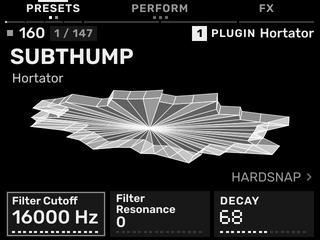

Explore MD-style TRX and EFM models alongside classic drum flavours and less conventional percussion. Choose a model first: its tune, decay, sweep, punch, noise, sub and clip settings reveal that model’s particular character.

Use Hortator alone for one focused playable drum voice, or use its different models across Rhythmer Kit pads. Hortator ACID is also the synthesis source of the separate Acid Engine entry.

**Try it for:** Punchy drum-machine parts, FM snares and toms, short percussive details and mixed-model kits.

### Aphex

**An MS-10/MS-20-inspired hybrid mono synth.**

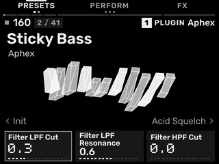

A characterful subtractive voice with resonant low-pass and high-pass filtering, oscillator shaping and modulation-generator controls. The two filter sections make it useful for both weighty bass and narrow, nasal or sharply resonant sounds.

Explore its presets, oscillator settings, filter peaks, modulation, portamento and patch variation controls. Input-dependent source models require an appropriate signal path; choosing a preset alone does not supply external audio.

**Try it for:** Rubbery bass, acid-like sequences, cutting leads, evolving bleeps and noisy synthetic textures.

### FM-106

**Juno-106-style subtractive synthesis.**

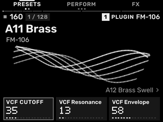

FM-106 combines DCO saw/pulse, pulse-width modulation, sub and noise sources with high-pass filtering, a resonant low-pass filter and an envelope.

Shape the oscillator balance, cutoff, resonance, filter-envelope amount, keyboard tracking, amp envelope and source effects. The original named factory bank is retained, including A11 Brass and A12 Brass Swell.

**Try it for:** Brass stabs, rounded bass, strings, chord beds and familiar polyphonic synth colours.

### FMini-1

**Minimoog Model D-style synthesis.**

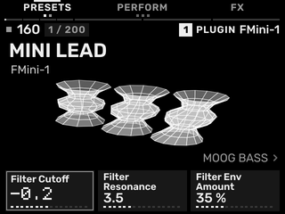

An oscillator-and-filter voice for solid low end and expressive lead lines. Its original oscillator, mixer, filter, envelope, modulation and effects controls are exposed through RHYTHMER’s sound editor.

Start from the original named sounds and adjust the source controls. RHYTHMER supplies the sequencing and project environment around the instrument.

**Try it for:** Weighty mono bass, singing leads, plucks, arpeggiated figures and warm sustained tones.

### CS-1

**CS-80-inspired layered synthesis.**

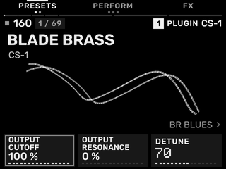

Two synthesis channels provide oscillator shaping, resonant high-pass and low-pass filters, separate envelopes and a sine component. Ring modulation, detuning and performance-oriented shaping extend the voice beyond a simple single-filter subtractive patch.

Explore the original brass, strings, flute-like and cinematic presets, then balance the channels, filter response, envelopes and available effects to fit the arrangement.

**Try it for:** Expressive brass, broad pads, layered leads, atmospheric chords and cinematic synth parts.

### OberVave

**Dual-oscillator colour, sync and cross-modulation.**

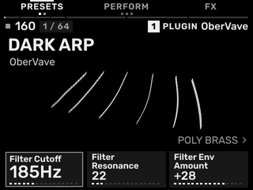

Mix two oscillators, shape pulse width, detune the pair, or use sync and cross-modulation for a stronger harmonic edge. The filter, envelopes and modulation give those raw sources movement.

Chorus, delay and reverb controls belong to the source sound; they are separate from RHYTHMER’s track inserts and send buses. Original named presets provide starting points for both tight and spacious patches.

**Try it for:** Poly brass, PWM strings, sync leads, detuned bass and bright cross-modulated tones.

### K-WASUB

**Layered oscillators, sub weight and lo-fi shaping.**

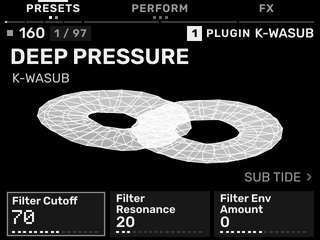

Oscillator A and B, a sub source and noise form the starting palette. Choose their source engines and blend them, then use the modulation matrix, filtering, drive and lo-fi controls to add movement and edge.

The individual plug-in focuses on the selected synthesis sound. K-WASUB’s drum-mode source is also available inside Rhythmer Kit, where it is treated as a pad sound rather than another complete kit track.

**Try it for:** Deep sub bass, Reese-like movement, gritty low-end parts and textured electronic leads.

### Hera

**Juno-60-style warmth from the Hera engine.**

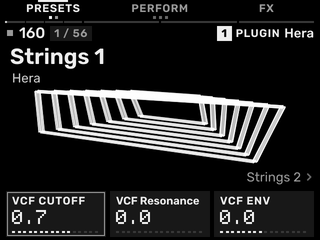

Blend saw, pulse, sub and noise with pulse-width modulation, then shape the result with the VCF and amp response. The DCO/VCF/VCA-style controls make it straightforward to move from a clean foundation to a more animated patch.

The original preset workflow and the ported source controls are retained. Its Juno-60 lineage complements FM-106’s separate Juno-106-inspired implementation; they remain distinct engines.

**Try it for:** Warm strings, round bass, organs, brass and uncomplicated chord layers.

### Braids

**A macro oscillator with contrasting synthesis colours.**

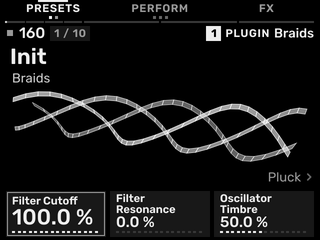

Choose an algorithm, then explore how Timbre and Color change that model’s spectrum and behaviour. A small set of meaningful controls can produce very different results between algorithms.

Amp and filter envelopes, FM amount, cutoff, resonance and filter-envelope controls shape the chosen oscillator into a playable sound. Model selection chooses the synthesis method; presets store a fuller sound configuration.

**Try it for:** Plucks, digital bass, bells, sharp stabs and unusual tonal or percussive textures.

### Plaits

**Twenty-four synthesis models, from tonal voices to percussion.**

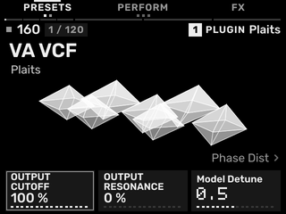

Move between contrasting virtual-analog, phase-distortion, FM and other model families. Timbre, Morph, harmonic shaping and the model-specific controls change meaning with the selected engine.

The port retains the original 24 models and 96 embedded six-operator FM programs, with named FM choices. Envelope/decay, LPG colour, modulation and the added neutral-by-default output filter help fit the sound to a part.

**Try it for:** Basses, chords, compact digital melodies, resonant textures and tuned percussion.

### MONO2K

**Monomachine-inspired sound machines.**

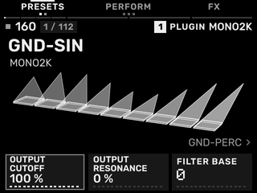

Choose a machine to change the underlying synthesis approach: the source families span ground tones/noise/percussion, SID-like character, FM, superwave and digital/voice-oriented sounds.

Machine-specific parameters sit alongside amp shaping, filtering, effects and three LFO sections. The selected machine runs as an instrument on a RHYTHMER track, using the OS sequencer and project storage.

**Try it for:** Electronic bass, bright digital melodies, synthetic percussion, chiptune-like edges and modulated textures.

### Prophet

**Polyphonic subtractive shaping with Poly-Mod.**

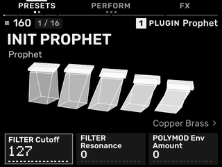

Oscillator, mixer, filter and envelope sections form the core, with Poly-Mod providing a route to more complex oscillator/filter movement. It can stay rounded and musical or become brighter and more animated.

The included selection is Init plus 15 identified Rhythmer-authored sounds. External Sequential factory patch data is not bundled. Sound edits remain reusable through User Sound presets and project saving.

**Try it for:** Chord stabs, polyphonic pads, bass, sync-like leads and evolving harmonic parts.

### S1Vave

**SH-101/S-1-inspired virtual-analog shaping.**

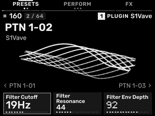

A saw/pulse oscillator, sub-oscillator and noise feed a resonant filter and envelope. PWM, modulation, glide and the source’s oscillator-shaping controls offer movement while keeping a direct subtractive-synth foundation.

The port keeps S1Vave separate from OberVave even where they share ancestry. Its own source controls and original presets define the instrument’s character inside the common RHYTHMER interface.

**Try it for:** Focused basslines, compact leads, plucks, animated arpeggios and pulse-based textures.

### Dexed

**Six-operator FM with a deeper patch vocabulary.**

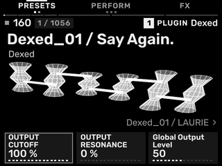

Operator levels, ratios, envelopes and their routing shape the harmonic result. Small changes can move a patch from a clean fundamental to a bright, metallic or complex spectrum.

The port uses the Dexed/MSFA lineage and its preset workflow. RHYTHMER also provides a neutral-by-default output filter for shaping the complete engine output without replacing the source’s original FM controls.

**Try it for:** Electric-piano-like tones, bells, glassy keys, FM bass and metallic or evolving patches.

### Guru-600

**Prophet-600-inspired synthesis.**

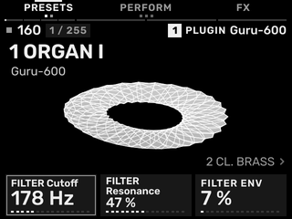

Two oscillators per voice, sync, a resonant filter with its own envelope, Poly-Mod and an LFO provide a classic subtractive starting point with room for stronger harmonic interaction.

The original named sound selection and available synth/effects controls are exposed in RHYTHMER’s editor. Guru-600 and Prophet remain separate ports, with separate source histories and preset policies.

**Try it for:** Brass and chord stabs, pads, bass, sync leads and Poly-Mod textures.

### Frodhes

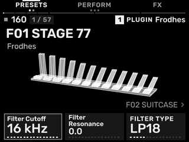

**Electric pianos and struck-bar instruments, calculated as you play.**

Four electric-piano models, vibraphone and marimba respond to velocity through the original physical-model synthesis. The port retains the original 57-program selection and source sound-design controls.

**Try it for:** Warm chords, electric-piano grooves, rounded mallet melodies and more forceful, velocity-driven accents.

### Tenebrae

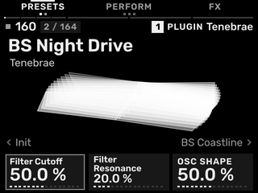

**Eight oscillator models with a darker, moving character.**

Saw, pulse, hard sync, FM, bell, wavetable, formant and pitch-drop models feed the original filter, modulation and effects. The original Init plus 163 named programs are retained.

**Try it for:** Driven bass, drifting pads, evolving leads, bells and textured electronic phrases.

### Amino

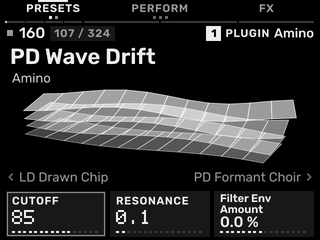

Wavetable synthesis with 324 original presets. Explore layered pads, moving textures, basses and leads.

### Fizzik

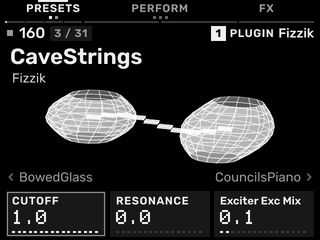

Physical-modeling synthesis with 31 original presets. Shape the exciter, two resonators, envelopes, modulation and effects.

### The drum palette inside Rhythmer Kit

DRUM-X, K-WASUB drum mode, 6W6, 8W8, 9W9, CW-78 and TR-MPC are kit-only sources. Sophie, Elixir and Hortator are available both as individual instruments and as kit-pad sources. The classic families cover 606-, 808-, 909- and CR-78-style drum colours without filling the main instrument list with kit-only duplicates.

Choose one of 69 complete kits, replace only the pads you want to change, then store the result as a User Kit. Native source effects, the whole-kit filter and the OS mixer/effects each have a separate role. [Kit and sound guide](docs/SOUND_KIT_GUIDE.md).

## From a sound to a groove

GEN can assign a kit and three complementary melodic roles to a chosen four-track group, or write MIDI for a range or a single track while keeping its instruments. A separate Chord GEN adds genre-based progressions, voicings and Block, Arp or Strum playing, following the project key/scale or a local override. Existing single-track generation remains available; Acid and Break retain their dedicated generators and performance workflows. The Melodee foundation supplies patterns, sequences, song arrangement, Freeze, mixing, effects, MIDI and USB features.

**Save sounds for reuse. Save projects for the music.** User Sound and User Kit presets keep instrument/kit settings; project saving preserves the surrounding tracks, patterns and arrangement. [Save/load instructions](https://jazzyrhythmer.github.io/mpc-sample/manual/#6-edit-the-sound-then-save-a-reusable-preset) · [First pattern](https://jazzyrhythmer.github.io/mpc-sample/manual/quickstart.html).

## Install the beta

Use the **complete SD ZIP** from the [installation page](https://jazzyrhythmer.github.io/mpc-sample/installer/). It includes the app, plug-ins, kits, preset catalogue and current guides. Check the matching SHA-256 before copying the contents to the card root.

Target: **MPC Sample AC50 with stock firmware 1.3.0.12, 1.4.0.7 or 1.4.0.8**. On 1.4, enable Developer Mode before direct installation. Back up the entire card first. Use the full SD ZIP for 0.3.0 so the app, plug-ins and catalogue match. Source archives contain corresponding code, not installers.

[Installation / stock-app recovery](docs/SD_CARD_GUIDE.md) · [Release files and notes](https://github.com/jazzyrhythmer/mpc-sample-rhythmer-os/releases)

## Source, credits and contributing

This repository contains the OS integration, runtime and corresponding port sources. The [engine-port repository](https://github.com/jazzyrhythmer/mpc-sample-engine-ports) provides the engine-focused view. To rebuild, start with [BUILD-0.3.0.md](docs/BUILD-0.3.0.md) and the matching application, engine-port and support-source archives.

Original engine names, licences and author credits are preserved. The current catalogue exposes 3,812 sound selections across 31 source views; original names and source credits are retained. External Sequential / Erica / Hrtl banks are excluded. [Original preset provenance](docs/ORIGINAL_PRESET_AUDIT_KO.md) · [Rhythmer presets](docs/RHYTHMER_PRESETS.md).

Built on Melodee by Kerem Kiliç (Ellic Studio) and contributors, with instruments and tools by their credited authors. [Full third-party notices](THIRD_PARTY_NOTICES.md) · [Component licences](LICENSES) · [Project licence](LICENSE).

This independent, unofficial project is not affiliated with or endorsed by AKAI Professional or inMusic. Product names and logos belong to their owners. Provided without warranty under the applicable licences.

If you find a problem, open an issue with the engine/preset, track type, exact button sequence and expected/actual result. Avoid uploading private projects or recordings without permission.

## Follow & support

[Instagram](https://www.instagram.com/jazzyrhythmer/) · [YouTube](https://www.youtube.com/@jazzyrhythmer) · [Patreon](https://www.patreon.com/JazzyRhythmer/) · [Leave a tip](https://ko-fi.com/jazzyrhythmer)

*In search of feel-good rhythms.*

## Matching release source

The `runtime/` tree in the OS repository contains the matching application source. `release-ports/` contains the source snapshots supplied with this release’s engine libraries, including their original notices. Refer to each project’s licence before reuse. The compiled plug-ins are in the full SD release package. No break recordings are bundled.

Built on **Melodee by Kerem Kiliç (Ellic Studio)**. Thanks to the original engine authors and open-source communities.

New sources: [Amino](https://github.com/klaine/amino) · [Fizzik](https://github.com/filliformes/fizzik-move) · [Weird Dreams](https://github.com/filliformes/weird-dreams-move) · [KrautDrums](https://github.com/filliformes/krautdrums-move). Their pinned references and notices are retained in `release-ports/`.
