# Your first groove with RHYTHMER OS.

RHYTHMER OS **0.3.0** · **4 bars · 140 BPM · C minor**. Build a drum, bass and chord pattern, then save it. Acid and Break are optional additions at the end. No downloaded break recording is required for the main exercise.

## Before you start

- Install the **full SD ZIP**, including `Rhythmer/Plugins`, not only UPDATE.
- Connect headphones or speakers and start at a low output level.
- Disconnect external MIDI clock for this exercise so you can set tempo locally.
- **Push** = press the large encoder. **Turn** = rotate it. B1–B3 are the buttons above the screen; K1–K3 are the knobs below it.
- Back/cancel is **SHIFT + encoder push**. SHIFT + encoder turn is fine adjustment, not Back.

| Track | Instrument | Preset | Pattern length |
| --- | --- | --- | --- |
| 1 | Rhythmer Kit | DRUM-X | 4 bars |
| 2 | FMini-1 | MOOG BASS | 4 bars |
| 3 | FM-106 | A11 Brass | 4 bars |
| 4, optional | Acid Engine | SQUELCH | Set before generation |
| 5, optional | Break Engine | Your own two-bar loop | Its prepared loop pattern may be 2 bars |

## 1. Create an empty project

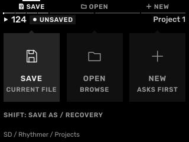

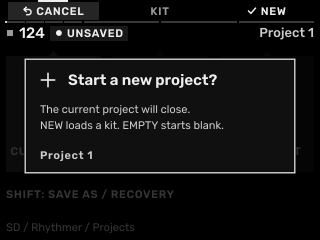

1. Press **SHIFT + Pad 16** to open Project.
2. Press **B3 NEW**. On its confirmation, press **B2 EMPTY**.
3. Select track 1: hold **PAD BANK**, tap **pad 1**, then release PAD BANK.
4. Press **SAMPLE**. You should have an empty sample-kit track.

**Check:** there are no notes or samples you need to keep in this new project. Choosing NEW is not a way to add an instrument to an existing project.

## 2. Load the drum kit on track 1

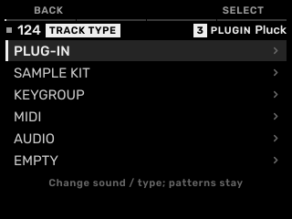

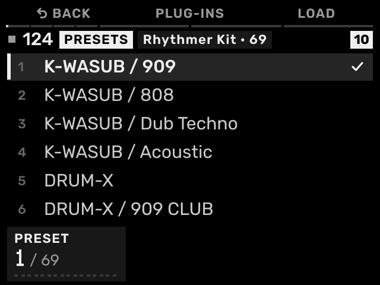

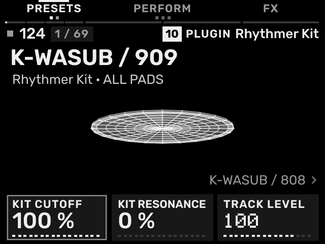

1. Press **PAD FX + KNOB FX together** to open MIXER.
2. Press **MENU → HERE → TRACK SETUP**, select **TRACK TYPE**, then **PLUG-IN**.
3. Choose **Rhythmer Kit** from the top of the plug-in list and push to load it.
4. Press **SAMPLE**, then B1 until **PRESETS** is selected.
5. Push to open the preset list, choose **DRUM-X**, then push / **B3 LOAD**.
6. Return to SAMPLE and use bank A. If necessary, tap PAD BANK until bank A is selected.
7. Play **pad 1 = kick**, **pad 2 = snare**, **pad 4 = closed hat**.

**Check:** each of those pads plays a different drum. If the list is empty, check the full installation and `Rhythmer/Plugins` before continuing. If every pad changes the pitch of one sound, check that the loaded engine is Rhythmer Kit rather than an individual drum sound.

## 3. Set tempo and the drum pattern length

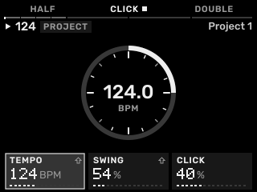

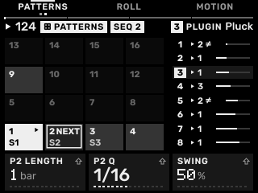

1. Hold **TAP TEMPO** and turn the encoder to **140 BPM**, then release it.
2. Press **SEQ**. If an editor opens, press B1 for SEQUENCES; press B1 again for **PATTERNS**.
3. Select **bank A, pad 1** for pattern 1.
4. On the pattern settings row, set **K1 LENGTH = 4 bars**, **K2 Q = 1/16**, **K3 SWING = 50%**.
5. Press **SAMPLE** before playing notes.

**Check:** the header still identifies track 1. The pads now play drums. On PATTERNS they select patterns instead. Pattern length belongs to this track; you will set it separately for tracks 2 and 3.

## 4. Record drums

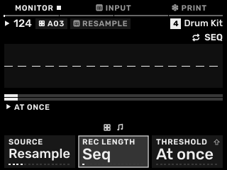

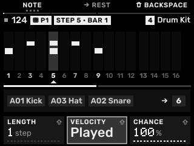

1. Enable a count-in if useful: **SHIFT + Pad 4** toggles it.
2. Press **SEQ RECORD**, then **PLAY**. Wait for the count-in if enabled.
3. Count **1, 2, 3, 4** in each bar. Tap kick **pad 1** on beats **1 and 3** for four bars.
4. Let the pattern loop. Add snare **pad 2** on beats **2 and 4**.
5. Let it loop again. Add closed hat **pad 4** on the counts **1-and-2-and-3-and-4-and**.
6. Press **SEQ RECORD** again to leave recording while playback continues. Press STOP when you want to stop.

**Check:** after recording is off, the drums repeat without you pressing pads. If pads switch patterns instead of making drum sounds, stop, press SAMPLE and start again. SHIFT + − undoes a supported recording edit. For precise corrections use SHIFT + SEQ for Step Edit; this exercise does not require it.

## 5. Load and record a bass on track 2

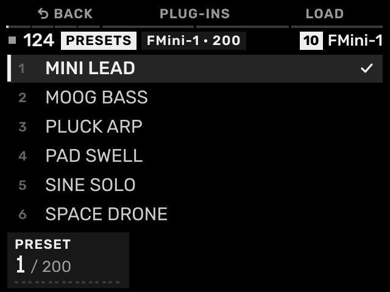

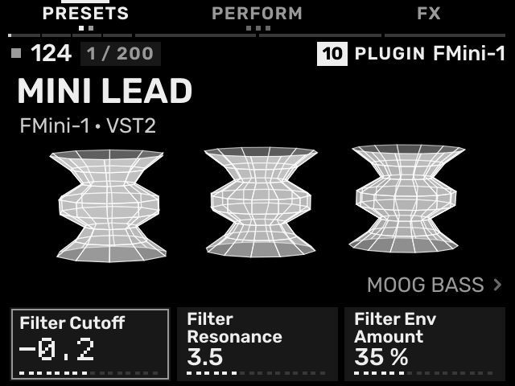

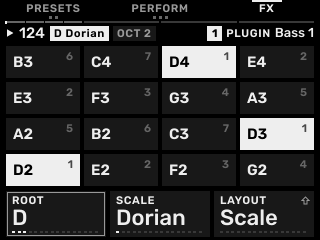

1. Hold **PAD BANK**, tap **pad 2**, release PAD BANK. Check **track 2** in the header.
2. The empty-track type cards appear. Choose **Plugin**, then **FMini-1**. If another screen remains open, press SAMPLE first.
3. On PRESETS, push for the list. Select **MOOG BASS**, then push / LOAD.
4. Hold **SAMPLE** for Keys. Set **K1 ROOT = C**, **K2 SCALE = Minor**, **K3 LAYOUT = Scale**, then release SAMPLE.
5. Press SEQ → B1 until PATTERNS, choose pattern 1, and set **4 bars / 1/16 / 50%** as on track 1.
6. Press SAMPLE. Try pads **1, 3 and 5**. Use −/+ to move the playable octave if needed.
7. Press SEQ RECORD → PLAY and record a short phrase with those pads. Leave space between notes. Press SEQ RECORD again to stop recording.

**Check:** drums still play from track 1; pads now play bass on track 2. A pad changes the bass note, not its preset. Selecting a track alone does not make PATTERNS pads become musical notes: SAMPLE does.

## 6. Add chords on track 3

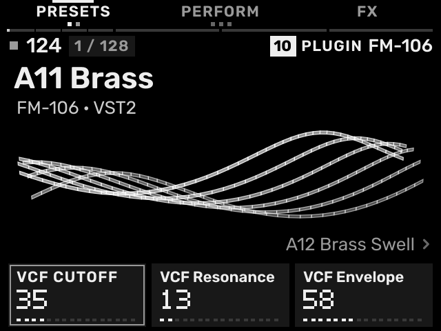

1. Select **track 3** with PAD BANK + pad 3.
2. Choose Plugin → **FM-106**. Open its preset list and load **A11 Brass**.
3. In Keys, confirm **C / Minor / Scale**. In PATTERNS, set pattern 1 to **4 bars / 1/16 / 50%**.
4. Press SAMPLE. Play pads **1, 3 and 5 together** for a minor chord.
5. Record short chord hits with SEQ RECORD → PLAY. Release the pads between hits. Turn recording off afterwards.

**Check:** the displayed preset name is **A11 Brass**. Release each chord before the next hit.

### Optional: generate the chord part instead of recording it

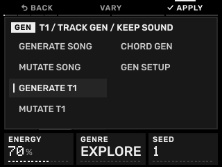

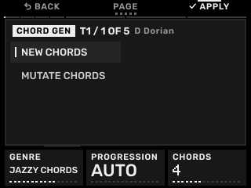

1. Keep **FM-106 on track 3**, then open **SEQ → B1 PATTERNS → SHIFT + B3 GEN**.
2. Select **CHORD GEN** and push the encoder. This is a separate entry from **GENERATE T3 / MUTATE T3**.
3. Page 1: choose **JAZZY CHORDS** or **NEO SOUL**, **PROGRESSION AUTO**, **CHORDS 4**.
4. Press **B2 PAGE**. Page 2: **BARS 4 / PATTERN 0% / CHORD COLOR 7THS**. After the first comparison, try 9THS or ADVANCED.
5. Page 3: **ENERGY 65% / PLAY STYLE BLOCK / GATE 80%**. Page 4: **VOICING AUTO / REGISTER OCT 4**. PLAY RATE has no job in BLOCK.
6. Page 5: leave **KEY SOURCE PROJECT**. The key/scale cards should show this guide's **C / Minor**. Do not change the project tempo or scale for this exercise.
7. Select **NEW CHORDS** and push / APPLY. It replaces only track 3's current pattern; track 1 drums and track 2 bass stay. Use **SHIFT + −** to restore the recorded version if preferred.
8. Press PLAY to hear it with drums and bass. For another harmonic progression, use NEW CHORDS again. MUTATE CHORDS keeps the progression and varies articulation.
9. To compare playing styles, set **PLAY STYLE ARP UP** and **PLAY RATE 1/8**, then **MUTATE CHORDS**. Compare **STRUM / NATURAL** the same way. Notes will be successive on a mono engine; FM-106 can play chord stacks.
10. **B1 BACK or SHIFT + encoder click** returns to GEN; another Back returns to PATTERNS.

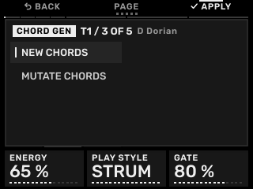

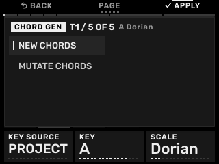

**Which command should I use?** GENERATE T3 / MUTATE T3 keep the original engine-adapted track generator, with genre, energy and seed. CHORD GEN gives explicit control over progression, chord changes, phrase length and playing style. Using CHORD GEN never changes the meaning of GENERATE T3. GENERATE SONG can replace the whole selected four-track group and change global tempo/key/scale; do not use it for this single chord-part exercise.

**Generate drums instead:** select track 1 with Rhythmer Kit → open GEN → choose the genre and **GENERATE T1**. Existing sounds stay loaded. A genre without a drum vocabulary, such as Neo Classic, shows no drum part and keeps the existing pattern.

## 7. Balance the tracks

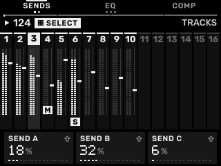

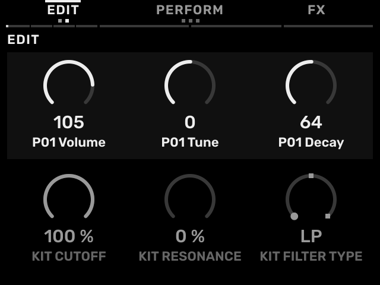

1. Press PAD FX + KNOB FX together for **MIXER**.
2. Select track 1, 2 or 3 using the encoder or PAD BANK + its pad.
3. Use the **fader** to balance its level. In FULL MIXER → SENDS, K1–K3 adjust sends A/B/C; press + for PAN/OUT/D. In BASIC, K1 is send A and SHIFT + K1 is pan.
4. To adjust the whole drum kit's filter: select track 1 → SAMPLE → B1 PRESETS → **KIT CUTOFF / KIT RESONANCE**.
5. To adjust only one drum's volume: track 1 → SAMPLE → B1 EDIT → hit that pad → first row **K1 Pxx Volume**. Check the P number before turning it.

For all four sends, press **B1 SENDS** in BASIC and choose **B3 ENABLE FULL**, or **B1 CANCEL** to stay in BASIC. In FULL, press B1 until SENDS is selected: K1/K2/K3 are A/B/C; press + for PAN/OUT/D and use K3 for D. Bus return levels belong to the bus channels: press PAD BANK in MIXER, select the labelled bus and move the fader.

**Check:** KIT CUTOFF affects all kit pads; Pxx Volume affects only the selected pad. ECHO/SPACE on PERFORM are separate track effects, not the main engine filter or sends A/B.

### Try a drum-pad mute

1. Keep the patterns playing with recording off. Select **track 1**, then press **SAMPLE**. Use Rhythmer Kit's **Drums** layout with **16 Levels off**.
2. Tap **MUTE**, then hit **pad 4** to remove the closed hat from the groove. Its LED turns red; the other drums, bass and chords keep playing.
3. Hit pad 4 again to restore it. Tap **MUTE** again to leave mute mode. You can also hold MUTE while hitting pads, then release it.
4. While mute mode is active, **SHIFT + a drum pad** solos that pad inside the kit; repeat on that pad to restore the populated kit pads. **SHIFT + MUTE** clears all project pad mutes and track mute/solo states.

**Check:** SAMPLE's Rhythmer Kit screen says **Mute: pads**. On MIXER, MUTE + pad still mutes whole tracks. Muting blocks new notes; existing releases and effect tails decay naturally. The project save below keeps the pad-mute state. If the kit is frozen, accept UNFREEZE and repeat the action.

## 8. Save and reopen

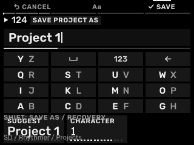

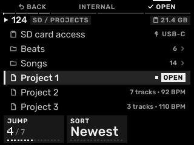

1. Press STOP and finish recording or printing.
2. Press **SHIFT + Pad 16**, release SHIFT, then press **B1 SAVE**. For this first save, choose a folder with the encoder: push enters it, SHIFT + encoder push goes up.
3. Press **B3 USE FOLDER**, enter **FIRST GROOVE 020**, then press **B3 SAVE**.
4. Wait for **SAVED**. Keep the original samples and plug-in folders on the card. Future B1 SAVE presses update this file; Project → **SHIFT + B1 SAVE AS** chooses another folder/name for a separate project.
5. To reopen: Project → **B2 OPEN** → choose the project → push → LOAD. With unsaved changes, choose SAVE, DISCARD or CANCEL.

Automatic recovery is separate: it updates one entry for this project under Rhythmer/Autosave, without overwriting your manual save. From the Project home tiles (SAVE / OPEN / NEW), **SHIFT + B3 RECOVERY** opens the recovery list. Use SAVE after loading a recovered copy to keep it deliberately.

**Check:** saving a project is different from saving a User Sound/Kit. The project is what preserves the drum, bass and chord patterns together.

## Optional: generate an Acid line on track 4

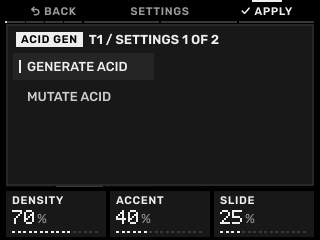

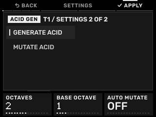

1. Select track 4 → Plugin → **Acid Engine** → preset **SQUELCH**.
2. Select pattern 1 and set the desired pattern length.
3. Open **SEQ → B1 PATTERNS → SHIFT + B3 GEN**.
4. Select **ACID GEN**, not GENERATE SONG.
5. Start with **DENSITY 70 / ACCENT 40 / SLIDE 25**. On settings page 2 keep **AUTO MUTATE off** for now.
6. Choose GENERATE ACID and push / APPLY. Press PLAY to compare it with the other tracks.
7. Back returns to GEN; another Back returns to PATTERNS. SHIFT + − undoes a generation operation.

**Do not apply GENERATE SONG to tracks 1–4 here.** SOUND + MIDI can replace the instruments and patterns you just recorded. ACID GEN and GENERATE T4 work on the selected track instead.

## Optional: add your own Break loop on track 5

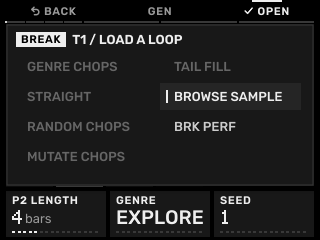

1. Put a loop you may use in the card's Samples folder. Start with a known **two-bar** loop.
2. Select track 5 → Plugin → **Break Engine**.
3. In the browser check **LOAD A** and set **K1 LOAD BARS = 2** before selecting the file and pushing.
4. Wait for preparation. BREAK GEN stays open; a straight pattern is prepared if the destination pattern was empty.
5. Press PLAY. A two-bar Break pattern can repeat while tracks 1–3 play four bars; their lengths do not have to match.
6. Choose **BRK PERF**. The first page, **1 ROLLS / HOLD PADS**, plays held effects. Turn the encoder to **2 CHOPS** to play individual slices.
7. To reopen setup: select track 5 → SEQ → B1 PATTERNS → SHIFT + B3 GEN → BREAK GEN.

If it plays at half/double the intended speed, check the source's bar count. Changing Grain knobs alone does not trigger stretching: hold pad 3 STRETCH on page 1, keep it held and turn to page 5. LOOP VARIATIONS requires LOOP mode, playback and PATTERN HOLD off. See the [Break instructions](MANUAL_020_EN.md#12-load-a-break-and-return-to-its-controls) before using those pages.

## If you get stuck

| What happened | Do this |
| --- | --- |
| I cannot find the sound page | Press SAMPLE |
| Pads switch patterns | Release SEQ; press SAMPLE |
| Wrong track is being edited | PAD BANK + target pad; check the header |
| No plug-ins listed | Check the full SD installation and Rhythmer/Plugins |
| B1 is a rate instead of TRACK SETUP | Turn off NOTE REPEAT / ARP, then reopen MIXER |
| I see Save Slot instead of synth controls | SHIFT + encoder push; return to sound-screen EDIT |
| I lost the Break menu | SEQ → B1 PATTERNS → SHIFT + B3 GEN → BREAK GEN |
| An effect or note will not stop | STOP twice within 400 ms |

The [full manual](MANUAL_020_EN.md) explains instrument replacement, User Sound/Kit saving and the six Break pages. Use the [button reference](QUICK_REFERENCE_020_EN.md) to distinguish selecting a track, opening its instrument and choosing its pattern.
