# RHYTHMER OS — User manual

RHYTHMER OS **0.3.0** for MPC Sample. Choose a chapter from the contents, or follow [Your first groove](FIRST_GROOVE_020_EN.md) to build and save a pattern from scratch.

## Essential controls

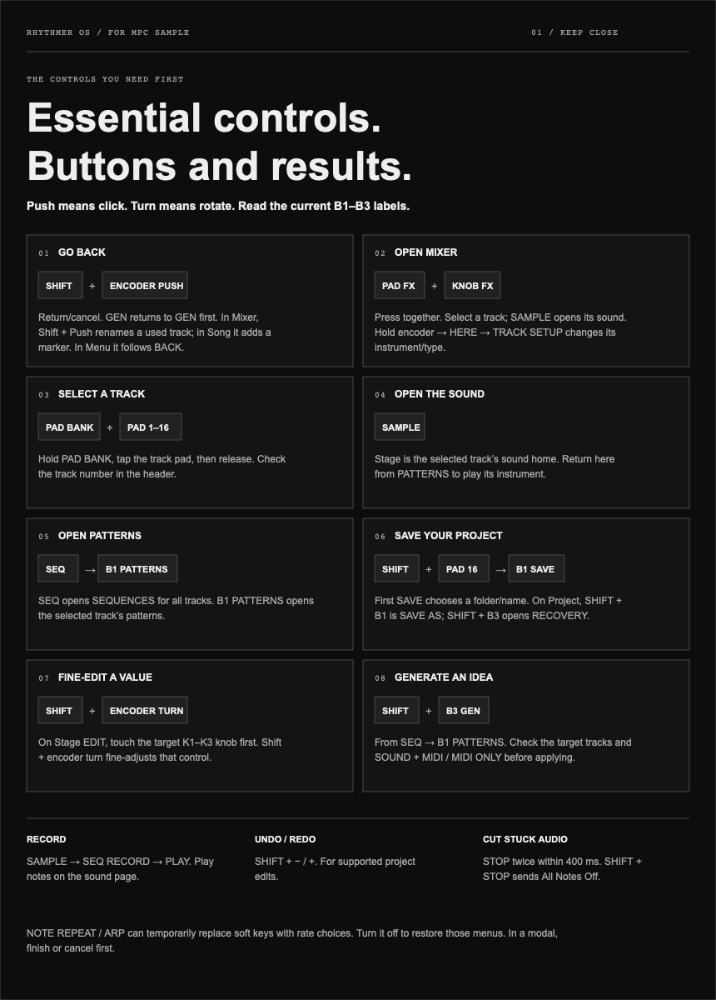

**Push** means press and release the large rotary encoder. **Turn** means rotate it. **B1 / B2 / B3** are the three buttons above the screen, from left to right. **K1 / K2 / K3** are the three knobs below it.

| Task | Controls | Result |
| --- | --- | --- |
| Return or cancel | Hold SHIFT, push the encoder, then release SHIFT | Back/cancel on most pages and in MENU. In MIXER it renames a used track; in SONG it adds a marker. |
| Open MIXER | Press PAD FX + KNOB FX together | Select and mix tracks; MENU → HERE → TRACK SETUP changes the selected track's instrument/type. |
| Select a track | Hold PAD BANK, tap pad 1–16, release PAD BANK | The header changes to that track. This does not record a note. |
| Play the selected instrument | Press SAMPLE | Pads play the selected instrument. |
| Choose patterns for one track | Press SEQ, then B1 until PATTERNS is shown | Pads choose patterns, not notes. |
| Launch sequences across tracks | Press SEQ, then B1 until SEQUENCES is shown | A sequence selects its numbered pattern on every track. |
| Open Step Edit | SHIFT + SEQ | Edit steps in the selected pattern. |
| Open GEN | PATTERNS → SHIFT + B3 | Open pattern generation. Check the target before applying. |
| Fine-adjust a value | Touch its K1–K3 knob, then SHIFT + encoder turn | Fine adjustment; this is **not** Back. |
| Undo / Redo | SHIFT + − / + | Undo/redo supported project edits. Not every plug-in knob has project Undo. |
| Save / Save As | SHIFT + Pad 16 → B1 SAVE; hold SHIFT + B1 for SAVE AS | First SAVE and SAVE AS choose a folder and name. |
| Stop all current audio | Press STOP twice within 400 ms | Cut notes and effect tails. A new note or PLAY resumes sound. |

A single PAD BANK tap changes the pad bank. Holding it while selecting a track does not. If NOTE REPEAT or ARP is active, rate choices can temporarily replace soft-key menus. Turn the repeat/arp off before following a menu instruction.

## System structure

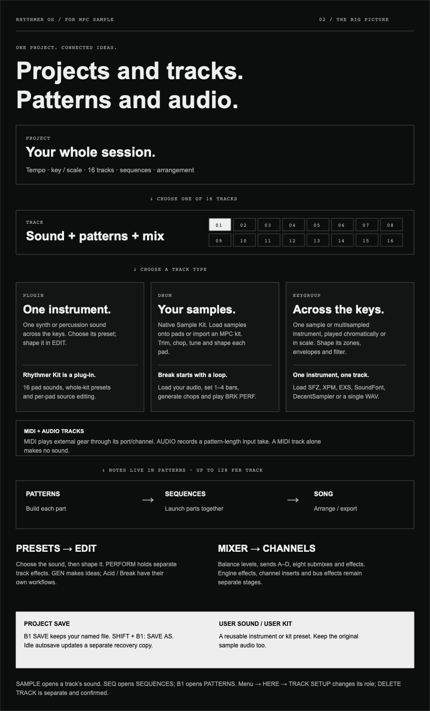

### The four things you select

| Item | Meaning | How to select it |
| --- | --- | --- |
| Project | The complete session: tracks, patterns, mix and arrangement | SHIFT + Pad 16 → SAVE / OPEN / NEW; SHIFT + B1 SAVE AS chooses a folder/name |
| Track | One part of the session; its instrument/audio, patterns and mix | PAD BANK + pad 1–16, or MIXER |
| Pattern | Notes and supported motion for one track; up to 128 per track | SEQ → B1 PATTERNS → pattern pad |
| Sequence | A pattern number launched across tracks | SEQ → B1 SEQUENCES → sequence pad |

A track with no notes in a launched sequence is silent. Changing just one track's pattern is done on PATTERNS. Select the track, choose its pattern, then press SAMPLE to play or record its instrument.

### What a track can contain

- **Drum / Sample Kit:** independently loaded audio pads. Load samples or an MPC kit.
- **Keygroup:** one sample or multisampled instrument played across notes.
- **Plugin:** one synth/percussion instrument. **Rhythmer Kit is a plug-in** with sixteen different pad sounds; other instruments focus on one sound across pitches.
- **MIDI:** notes/control sent to an external instrument. It needs external audio routing to be heard.
- **Audio:** an input take recorded against a pattern.
- **EMPTY:** no instrument. TRACK TYPE can make a track EMPTY while keeping its patterns. DELETE TRACK separately removes its sound and patterns after confirmation.

A first install starts in Basic. Track types remain available in both modes. Settings → FEATURES = FULL exposes advanced pages such as Sends and Motion/Mod/Macro. Existing project content is not deleted when switching modes.

### Where a change applies

| Control | Applies to |
| --- | --- |
| P11 Volume / P11 source parameter | Selected Rhythmer Kit pad 11 |
| KIT CUTOFF / KIT RESONANCE | The whole Rhythmer Kit |
| Individual engine CUTOFF / RESONANCE | The current instrument; linked between PRESETS and EDIT |
| Track LEVEL / PAN / PERFORM | The selected track |
| SEND A–D | Sends from a track/pad to shared buses, according to track type |
| Project key/scale/tempo | Shared project settings |

### Save the right thing

- **Project:** the session, including notes, arrangement and instrument state. SAVE keeps the project; idle autosave updates a separate recovery copy. SAVE AS makes a separate project.
- **User Sound:** a reusable instrument sound, without the song's notes.
- **User Kit:** a reusable kit and its edited pad sounds, without the song's notes.
- **SD backup:** keeps source samples and all project/preset files. Saving a preset is not a source-audio backup.

### Choose the screen for the task

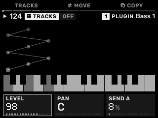

| Screen | What the pads do | Use it for |
| --- | --- | --- |
| SAMPLE sound screen | Play notes, kit sounds or sample chops | Audition, record notes, choose presets and edit sounds |
| MIXER | Select tracks | Track faders, pan/sends, EQ and compression; MENU → HERE → TRACK SETUP changes type |
| SEQUENCES | Launch one sequence across tracks | Change several tracks together |
| PATTERNS | Launch patterns on the selected track | Pick the pattern you will edit or generate |
| Step Edit / Roll | Edit steps or note events | Program or correct the selected pattern |
| BRK PERF | Play chops or performance commands, depending on its numbered page | Perform the Break Engine |

The header identifies the selected track. Check it before loading, editing or generating. Selecting track 2 does not automatically mean you are playing its notes: press **SAMPLE** to play its instrument. Older documents call this sound screen “Stage”.

If a pad changes a pattern number instead of playing a sound, you are on PATTERNS or holding SEQ. Release SEQ and press SAMPLE.

## 3. Start a project and add an instrument

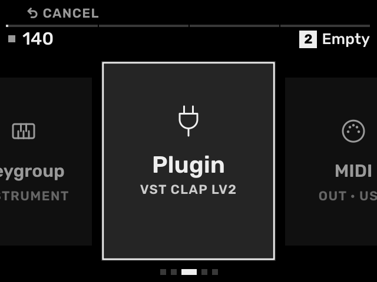

A normal NEW project loads **Rhythmer Kit / K-WASUB / 909** on track 1. Opening a saved project keeps its saved instruments. To start with an empty kit instead: **SHIFT + Pad 16 → B3 NEW → B2 EMPTY** on the confirmation. Do this only when you intend to start a new project.

To add a plug-in on a different track:

1. Hold **PAD BANK**, tap an unused track pad, then release PAD BANK. Check the track number.
2. If necessary press **SAMPLE**. An EMPTY track shows type cards.
3. Turn the encoder to **Plugin** and push it.
4. In the plug-in browser, turn to the engine name and push to load it.
5. Wait for loading to finish. Press **SAMPLE** to play it.

The type cards are **Drum / Keygroup / Plugin / MIDI / Audio**. The existing-track **TRACK TYPE** menu also offers **EMPTY**; these types are available in Basic and Full. To show Full: **SHIFT + Pad 8 → Settings → K1 FEATURES = FULL** on the main Settings page. Changing Basic/Full does not delete tracks or notes.

| Type | What it contains | What to load |
| --- | --- | --- |
| Drum | A native sample kit with independently loaded pads | Samples, an MPC kit or input recording |
| Keygroup | One sample or multisampled instrument across the keys | WAV, SFZ, MPC keygroup program, EXS, SoundFont or DecentSampler instrument |
| Plugin | One plug-in instrument | An engine from the installed plug-in list; Rhythmer Kit is also here |
| MIDI | Notes sent to external equipment | Choose an output port/channel; connect the external instrument's audio separately |
| Audio | A recorded input take on the track's pattern | Configure INPUT, then record with SEQ RECORD + PLAY |

Drum and MIDI have a second source-selection step. **B1 BACK / SHIFT + encoder push** returns from sources to types, then to the previous track screen. An entirely empty project can return to MIXER.

An intentionally empty **Sample Kit** is not the same as an EMPTY track. On its **SOUND / TRIM** page, encoder push opens **SAMPLES** for the selected empty pad, even when every pad is empty. To change this track’s type, use **MIXER → hold encoder → HERE → TRACK SETUP → TRACK TYPE**. The printed **SAMPLE SELECT** button opens the same sample browser; **SAMPLE RECORD** opens input recording.

## 4. Replace an instrument or change track type

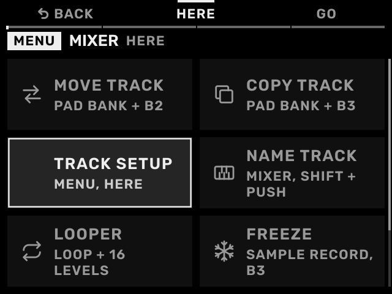

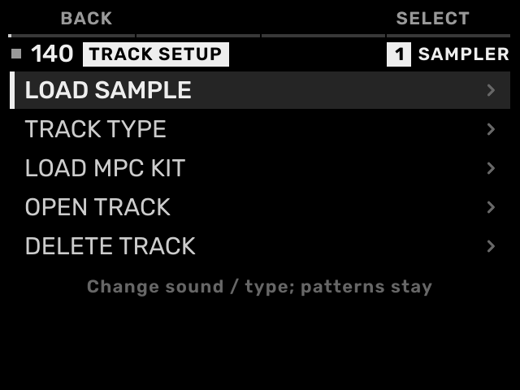

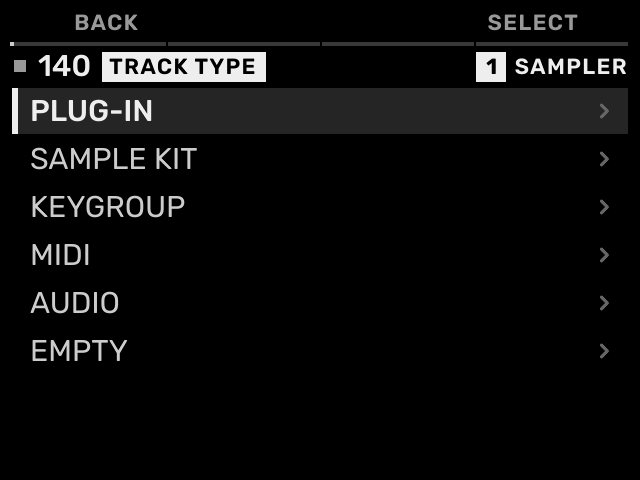

**Start:** select the target track, then press **PAD FX + KNOB FX → hold encoder → HERE → TRACK SETUP**.

| Item | What it changes | What it keeps |
| --- | --- | --- |
| CHANGE PLUG-IN | The selected track's plug-in | Patterns and track mix; confirm replacement when asked |
| LOAD SAMPLE on a sample track | The selected pad's sample | Other pads and the track's patterns |
| TRACK TYPE | Plugin / Sample Kit / Keygroup / MIDI / Audio / Empty in Basic and Full | All 128 patterns, selected pattern and track mix; type-specific sound state is replaced |
| LOAD MPC KIT | The kit from a project/program | Destination patterns; it does not open the whole source project |
| DELETE TRACK | Sound and patterns | This is a separate confirmed deletion; Undo can restore it |

You can also open an instrument's preset list and press **B2 PLUG-INS**, or press **SAMPLE SELECT** on its plug-in track. These enter the instrument browser. Effect preset lists do not replace track instruments.

**Back before confirming** keeps the current instrument. Recording and frozen tracks have additional protections: finish the recording, or answer the thaw/unfreeze prompt before replacing them. Selecting another track from an instrument-owned browser closes that browser and opens the new track's sound screen. Bus/master effect screens remain shared.

## 5. Find and load presets

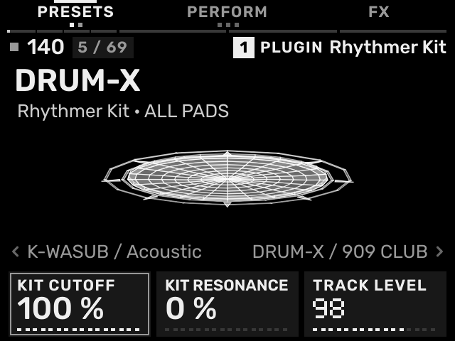

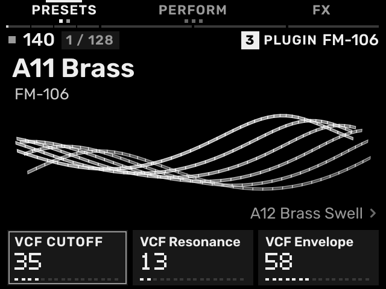

1. Select the plug-in track and press **SAMPLE**.
2. Press **B1** until its **PRESETS** page is selected. The engine and current preset name are shown.
3. Turn the encoder to step through presets from the main page. Push it to open the full list.
4. In the list, turn to an item, then **push / B3 LOAD** to load it. Moving the list cursor alone does not load it.
5. Use **B1 BACK** or **SHIFT + encoder push** to return. B1 moves up a preset folder before leaving it.

Encoder and −/+ navigation wrap from the last preset to the first, and back. This applies inside the current preset folder; User Sound / User Kit entries participate in the list. Loading a factory preset can replace your unsaved sound edits. Save a User Sound/Kit first if you want to keep them.

A normal instrument plays **one sound across pitches**. It does not assign a different factory preset to every pad. Use Rhythmer Kit when you want sixteen different sounds on one track.

### Factory presets

| Engine | Included original presets | Notes |
| --- | --- | --- |
| Amino | 324 | The original factory bank and embedded waves |
| Fizzik | 31 | The original factory bank |

## 6. Edit the sound, then save a reusable preset

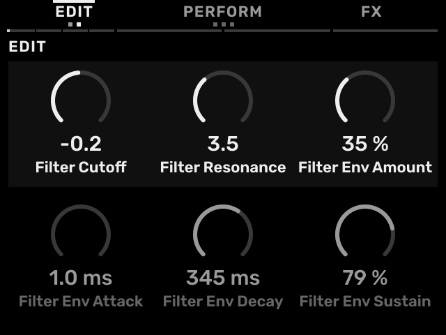

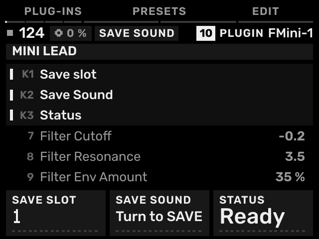

On a plug-in sound screen, **B1 cycles PRESETS / EDIT**. Press it until **EDIT** is selected.

- Turn the encoder to move through rows of up to three controls. The visible names identify the current row.
- Turn **K1 / K2 / K3** to edit the corresponding visible values.
- To fine-adjust, touch that knob first and hold **SHIFT** while turning the encoder.
- ENV/LFO/FX controls appear when the original engine provides them. They are sound controls, not a requirement to add a separate project modulator.
- The PRESETS main filter and its matching EDIT control are linked. They do not create a second filter.

If you see **Save Slot / Save Sound or Save Kit / Status**, you are in the save tool, not a sound-design row. Press **SHIFT + encoder push** to return to the sound editor.

To save a User Sound:

1. From the sound screen's **EDIT**, push the encoder to open its tools.
2. Select **SAVE** if it is not already open.
3. Set **K1** to a slot, turn **K2 SAVE SOUND**, and wait for **K3 STATUS = READY**.
4. Return to **PRESETS**, open the list, select the saved **User Sound** and push / LOAD to reload it.

The same slot is overwritten. User presets save instrument settings, not the song's notes or original sample files. Save the project separately and keep source samples on the card.

## 7. Use Rhythmer Kit

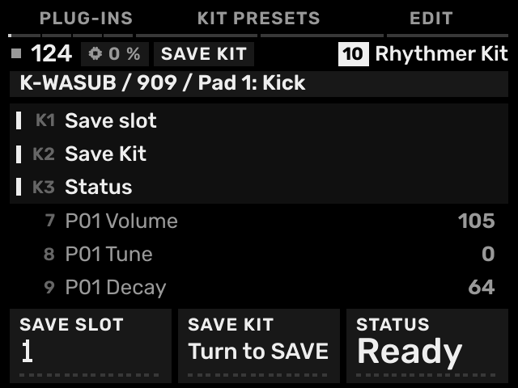

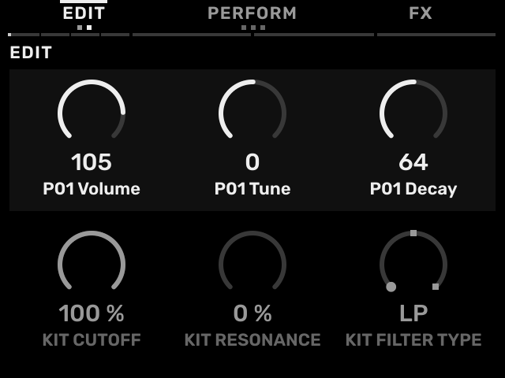

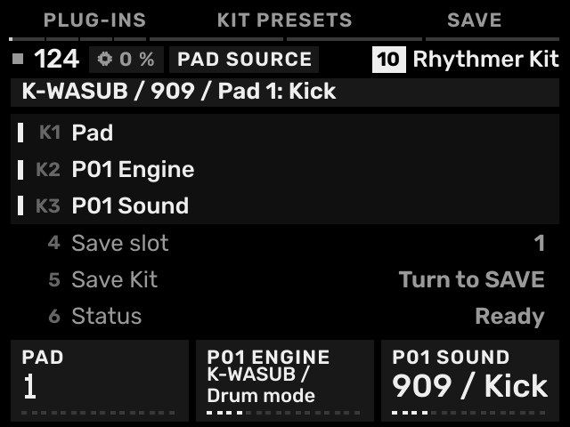

Load **Rhythmer Kit** from the top of the plug-in list. It has **69 complete factory kits**, with pads 1–16 filled. Start with bank A.

Rhythmer Kit includes 32 Weird Dreams kits made by pairing its 64 original eight-voice banks, plus one KrautDrums kit with all 16 original voices. Source patches keep their original values. Pad routes are ordered for Rhythmer's GEN lanes. KrautDrums uses its second snare in the clap lane; the original source has no clap instrument. Both sources are selected inside Rhythmer Kit rather than as separate instruments in the main plug-in list.

| Task | Procedure | Check |
| --- | --- | --- |
| Change the whole kit | PRESETS → choose another kit | Multiple pad sounds change |
| Change one pad's source | Sound screen EDIT → encoder push → PAD SOURCE; hit the pad, then K2 ENGINE / K3 SOUND | The selected P number and engine/sound name match the pad |
| Mute / unmute one pad | SAMPLE → MUTE → hit the pad; hit it again to unmute | Only that pad stops starting new notes |
| Change one pad's volume | Return to the sound screen's EDIT; hit the pad; use the first row's K1 Pxx Volume | Only that pad's level changes |
| Shape the whole kit | PRESETS KIT CUTOFF / KIT RESONANCE | All pads pass through the same whole-kit filter |
| Save the whole kit | Tools → B3 SAVE → K1 slot → K2 SAVE KIT → STATUS READY | User Kit appears in KIT PRESETS |

The tool's **B3** cycles **PAD SOURCE → SAVE → EDIT**. Its **B2 KIT PRESETS** opens the preset list. **SHIFT + encoder push** returns to the original sound-editor position.

**KIT …** means a whole-kit control. **P01 … / P11 …** means that selected pad's control. Hit a different pad to edit it. A pad's engine can also have its own filter. This is separate from the whole-kit filter. Do not expect the KIT CUTOFF value to change when selecting another pad.

### Mute and solo kit pads

1. Select the Rhythmer Kit track and press **SAMPLE**. Use its **Drums** pad layout and leave **16 Levels** off.
2. Tap **MUTE** to latch mute mode, then hit a pad to mute/unmute it. Alternatively, hold MUTE while hitting pads and release MUTE afterwards.
3. While mute mode is active, **SHIFT + pad** solos that populated pad across banks A–D. Repeat on the soloed pad to restore the populated pads.
4. Tap **MUTE** again to leave latched mute mode. Pad mute settings remain active while patterns and live notes play.

Muted pad LEDs are red; a soloed pad is white. The screen says **Mute: pads** and shows the affected pad number after a change. **SHIFT + MUTE** clears all pad mutes and track mute/solo states across the project. On **MIXER**, MUTE + pad still operates on whole tracks. Hold PAD BANK to select a different track as usual.

Pad mute blocks new notes from the pads, sequencer and incoming MIDI; existing release and effect tails decay naturally. It does not change pad volume, the sound design or the recorded pattern. Mutes belong to the project, survive project save/load and remain when changing the kit preset. User Kit presets do not store track mute settings. A frozen kit plays a stereo print: accept the existing UNFREEZE prompt, then repeat the mute action to edit its individual pads.

## 8. Load samples or an MPC kit

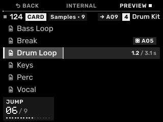

### Load a file onto one pad

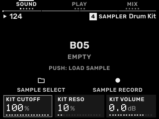

1. Select a **Drum / Sample Kit** track. Press **SAMPLE** and hit the destination pad.
2. Press **SAMPLE SELECT**. Check the destination track/pad in the browser header.
3. Use the encoder to choose folders/files. **B2 CARD / INTERNAL** switches storage. **B3 PREVIEW** auditions files as you select them.
4. Push on a file to load it onto that pad. Wait for loading to finish.
5. Press **SAMPLE**, then hit the pad to check it. Other pads remain as they were.

WAV, MP3, FLAC, Ogg Vorbis and AIFF are supported. A long file may be streamed or cached; allow preparation to finish. On SOUND/TRIM, encoder push on an empty selected pad opens the same sample browser, including when all pads are empty. SAMPLE SELECT opens it directly; SAMPLE RECORD opens input recording.

### Load only a kit from another MPC project

Select the destination track, open **MIXER → hold encoder → HERE → TRACK SETUP → LOAD MPC KIT** and choose the project/program. Use **B2** to choose card/internal storage when offered. This loads its kit onto the selected track; opening a project from the **Project OPEN** screen is a different action and replaces the current project.

On the native sample track, press **B1/B2/B3 repeatedly until the required caption appears**: SOUND, TRIM, TUNE, AMP ENV, PLAY, MIX, FILTER and FILT ENV are available in Basic. Full adds layers, colour, sends, follow, cloud and kit-filter pages. A direct Trim shortcut can enter TRIM instead of SOUND.

## 9. Record and play patterns

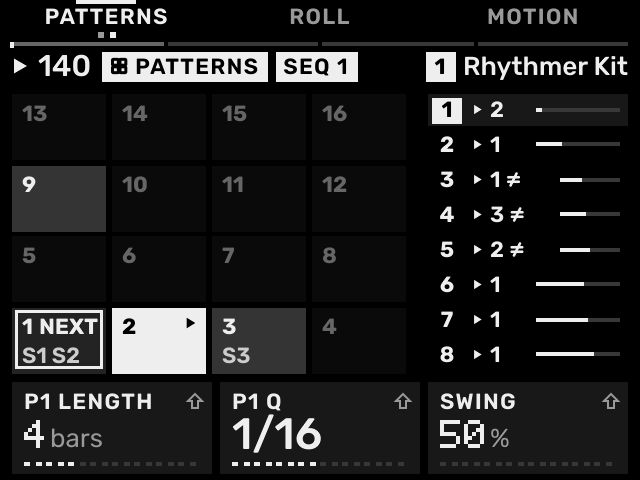

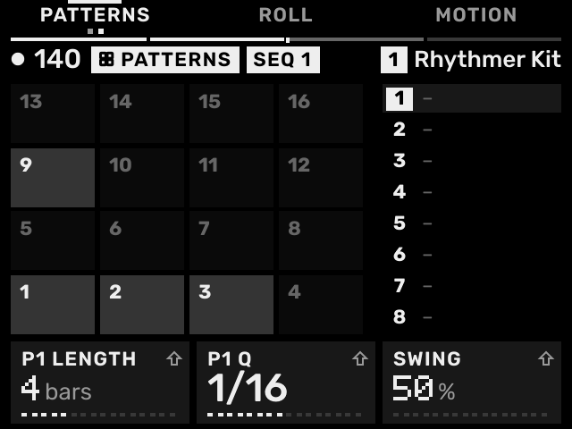

A track's **pattern** stores its notes and supported motion. A **sequence** launches its numbered pattern across tracks. Track 1 pattern 1 and track 2 pattern 1 are different patterns.

1. Select the track. Press **SEQ**, then **B1 PATTERNS**.
2. Select the pattern pad you want to use. Bank A pad 1 is pattern 1.
3. Set **K1 LENGTH**, **K2 Q** and **K3 SWING** on the pattern settings row. Start with 4 bars, 1/16 and 50%.
4. Press **SAMPLE** to return to note-playing pads.
5. Press **SEQ RECORD**, then **PLAY**. Play the pads after any count-in.
6. Press **SEQ RECORD** again to stop recording while playback continues. Press **STOP** to stop playback.

If pads switch patterns, return to SAMPLE before recording. If you hear no click, use TAP TEMPO's click controls; you can also enable the count-in with **SHIFT + Pad 4**. Use **SHIFT + SEQ** for Step Edit, or the sequence editor's Roll page to correct notes. Read the editor's current header to confirm the track and pattern.

On **SEQUENCES**, pad 1 launches pattern 1 on all tracks. A track with no notes in that sequence is silent. Use **PATTERNS** when you want to change just one track. 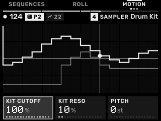

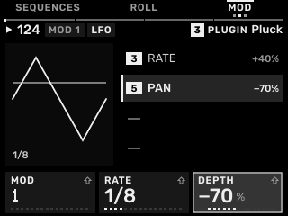

Full exposes Motion/Mod/Macro; B3 cycles them and SHIFT + B3 ADD adds a supported target. A plug-in's internal LFO and the project's MOD page are different systems.

## 10. Generate notes without losing the wrong track

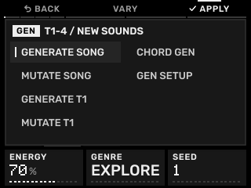

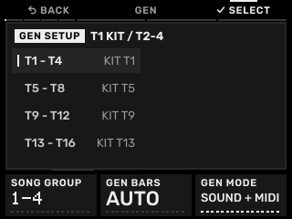

**Entry:** select the target track → **SEQ → B1 PATTERNS → SHIFT + B3 GEN**.

| Operation | Result | Instruments |
| --- | --- | --- |
| GENERATE SONG | Generate the selected 4-track group | SOUND + MIDI assigns a kit to its first track and instruments to the next three |
| MUTATE SONG | Vary that group's current patterns | Existing instruments stay |
| GENERATE Tn / MUTATE Tn | Existing engine-adapted generation on the selected track | Its instrument stays; Rhythmer Kit receives drum patterns |
| CHORD GEN | Explicit chord progressions, Block / Arp / Strum, on the selected instrument track | Its instrument stays; separate from GENERATE Tn |
| GENERATE MIDI / MUTATE MIDI | Work on the range in GEN SETUP | MIDI ONLY keeps the instruments |
| ACID GEN / BREAK GEN | Open engine-specific generation | Shown only for the matching track |

For four-track generation, open **GEN SETUP**, set **K3 GEN MODE = SOUND + MIDI**, choose **K1 SONG GROUP = 1–4 / 5–8 / 9–12 / 13–16**, and confirm. This can change that group's instruments and patterns. Use an unused group if you want to keep an existing part.

For one track or a range without instrument replacement, choose **MIDI ONLY** in GEN SETUP and set **MIDI FROM / TO**. Identical start/end track numbers target one track. A GENERATE Tn command is also a direct one-track action.

Back returns **sub-generator → GEN main → PATTERNS**. Applying generation remains in the generator so you can compare another result. **SHIFT + −** undoes a supported generation operation. General GEN exposes Seed; Acid GEN does not.

### Track GEN and Chord GEN are separate

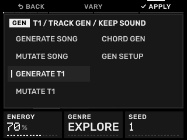

**GENERATE Tn / MUTATE Tn** retain the original engine-adapted track workflow and its genre/energy/seed controls. They do not switch to Chord GEN after you have used it. A melodic part can include chords when its original genre/role calls for them. Rhythmer Kit receives the selected genre's drum part; Acid and Break retain their specialized routes.

**CHORD GEN** explicitly controls a harmonic progression and how its notes are played. Only NEW CHORDS / MUTATE CHORDS inside that screen use its settings. It changes the selected track's current pattern, keeps the instrument and other tracks, and leaves project BPM/key/scale unchanged.

### Generate chords on one track

1. Select the instrument track and open GEN.
2. Select **CHORD GEN** and push the encoder. The sound remains loaded. **GENERATE Tn / MUTATE Tn** remain separate, engine-adapted single-track generation commands.
3. **B2 PAGE** cycles five pages; the header shows the page count and current key/scale.
4. Set **CHORDS** (1–8 chord changes across the phrase) and **BARS** (1–16). **PATTERN** changes rhythmic density; **CHORD COLOR** changes harmonic complexity.
5. Set **ENERGY** for accents/dynamics, **PLAY STYLE** for block chords, arpeggios or strum, and **GATE** for note length. **PLAY RATE** is arp subdivision or strum spacing; it is inactive for block chords.
6. Use **VOICING / REGISTER** to set spacing and pitch range. Mono instruments play successive chord tones.
7. **KEY SOURCE = PROJECT** follows the project. Changing KEY or SCALE selects **LOCAL**, affecting only generated notes. Advanced, borrowed and chromatic progressions may contain intentional non-scale tones.
8. Choose **NEW CHORDS** and push. **MUTATE CHORDS** retains the harmonic progression and varies articulation. Undo restores the notes and generation state. Back returns to GEN.

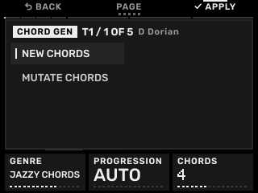

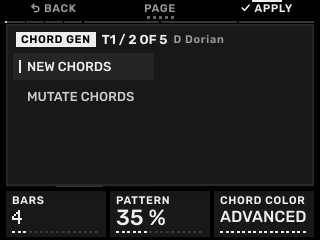

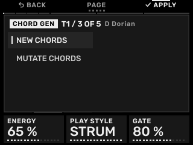

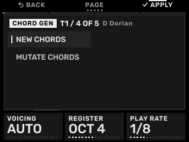

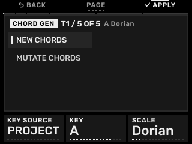

CHORDS means harmonic changes across the whole phrase: 4 chords over 4 bars gives one chord per bar; 4 chords over 8 bars gives two bars per chord. PATTERN controls repeated hits within each chord rather than adding more chord changes. Start with PATTERN 0% to compare Block, Arp and Strum clearly.

CHORD COLOR selects triads, sevenths, ninths or advanced extensions. Jazz/neo-soul profiles use genre-aware progressions and voice leading. Borrowed/chromatic progressions and advanced dominants can intentionally contain non-scale notes. AUTO voicing may omit a root or fifth; choose CLOSE if you want a more explicit chord stack.

PLAY RATE sets arp quarter/eighth/sixteenth/thirty-second notes, or strum TIGHT/NATURAL/LOOSE/WIDE spacing. It is inactive for BLOCK. ENERGY controls accents/dynamics; GATE controls note duration. Mono engines play successive chord tones instead of a simultaneous block/strum.

Acid Engine, Break and Rhythmer Kit use their dedicated generators. Chord generation does not change project BPM, swing, time signature, key or scale. New SOUND + MIDI Song generation keeps its existing global tempo/key/scale behavior; GEN SETUP LENGTH chooses AUTO or a target-pattern length of 1–16 bars. For Rhythmer Kit, select GENERATE Tn and choose the desired genre. If that genre has no drum vocabulary (for example Neo Classic), no drum part is shown and the existing rhythm stays intact.

## 11. Use Acid GEN

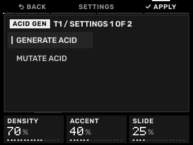

1. Load **Acid Engine** on the selected track and choose a preset, for example **SQUELCH** or **Acid Squelch**.
2. Open **SEQ → B1 PATTERNS → SHIFT + B3 GEN → ACID GEN**.
3. On **SETTINGS 1 OF 2**, K1 DENSITY changes note density, K2 ACCENT the accented-note amount, K3 SLIDE the slide amount.
4. Press **B2 SETTINGS** for **2 OF 2**: OCTAVES, BASE OCTAVE and AUTO MUTATE. Keep AUTO MUTATE off for the first test.
5. Select **GENERATE ACID**, then push / **B3 APPLY**. Press PLAY to hear it.
6. Use **MUTATE ACID** to vary the current line. Back returns to GEN; another Back returns to PATTERNS.

The project key/scale is used. Seed is managed internally; there is no SEED knob or REPLAY SEED item. AUTO MUTATE changes the line at the chosen bar interval during supported pattern playback; it is disabled during recording and song playback. Turn it off when you want a repeatable recorded part.

## 12. Load a Break and return to its controls

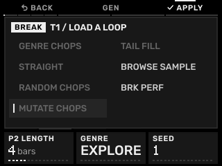

Use a loop that you own or can use. Know its actual length in bars; this guide starts with **2 bars**.

1. Select an unused track → **Plugin → Break Engine**.
2. In the browser, check **LOAD A** and set **K1 LOAD BARS = 2** for the two-bar loop. Select its WAV and push.
3. Wait for preparation. The **BREAK GEN** menu stays open. A previously empty pattern receives a straight pattern; an occupied pattern is preserved.
4. Press PLAY. If the bar count is correct, the loop should follow project tempo. If it runs at half/double the intended speed, check the source bar count before generating more patterns.
5. Choose **BRK PERF** for performance pages. To reopen the generator later: select the Break track → **SEQ → B1 PATTERNS → SHIFT + B3 GEN → BREAK GEN**.

Selecting Break Engine is not the same as loading its source audio: the change is committed after successful file loading. **B1 CANCEL / SHIFT + push while loading** cancels assignment. A later completed decode must not replace another selected track.

For a new rhythm, select **Straight / Genre / Random / Mutate / Tail Fill** in BREAK GEN and apply it. These change notes/chop order in the pattern. They do not by themselves enable LOOP variation or a STRETCH performance command.

### BRK PERF: what each page does

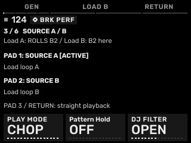

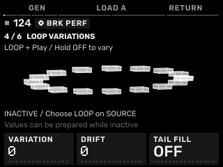

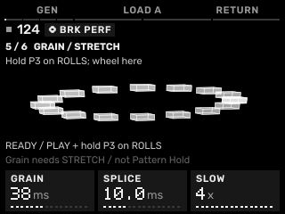

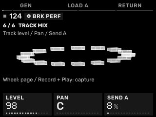

Turn the encoder to move through the six numbered pages. The caption shows your position. Hold a performance pad while changing pages to keep its effect active; releasing the pad ends it. Performance-pad velocity does not lower the break’s level. Use TRACK MIX or MIXER to set its level.

| Page | Action to try | What must be true / expected result |
| --- | --- | --- |
| 1 ROLLS / HOLD PADS | Hold a repeat pad while the pattern plays; release it | Hear the held command; releasing ends it. Pad 3 is STRETCH. |
| 2 CHOPS | Hit pads 1–16 | Play the loop's sixteen slices. B2 LOAD A browses source A. |
| 3 SOURCE A / B | B2 LOAD B, then choose B; pad 1 selects A, pad 2 selects B | B must be loaded first. Pad 3 / RETURN restores straight playback. |
| 4 LOOP VARIATIONS | Set SOURCE's PLAY MODE to LOOP; set PATTERN HOLD off; raise Variation or Drift | These variations act in LOOP playback. They do not vary ordinary CHOP playback. |
| 5 GRAIN / STRETCH | Hold pad 3 on page 1, keep it held and turn the encoder to page 5 | Adjust grain processing while STRETCH is active. Merely turning these knobs does not start STRETCH. |
| 6 TRACK MIX | Adjust level, pan and send A | Mix the Break track; these are not source-bar or chop controls. |

**PATTERN HOLD** stops internal LOOP-pattern regeneration. It is not audio freeze, a sustained-note switch or the switch for Grain. If the status says **INACTIVE**, **WAITING** or **READY**, read its condition before expecting a change. Page 5 needs STRETCH; page 4 needs LOOP, playback and Hold off.

Load A and Load B are different actions. On source B changes, the bar structure must match the prepared loop. Replacing A with a different length asks for confirmation; Back cancels it. Use Undo/Redo to compare a completed source replacement. Keep the audio files on the card when saving the project.

## 13. Mix and identify the filter/effect you are changing

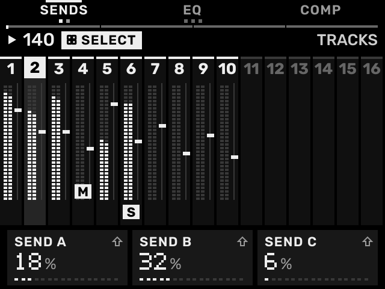

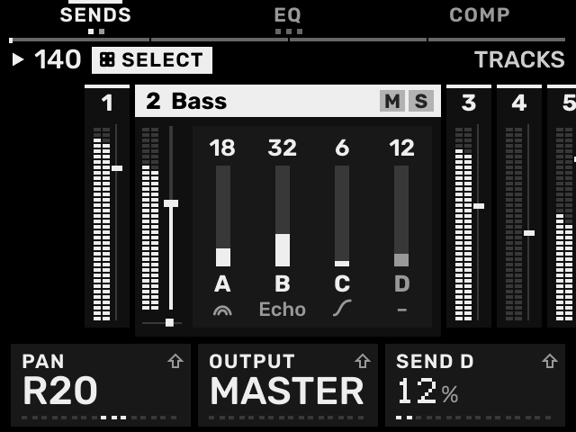

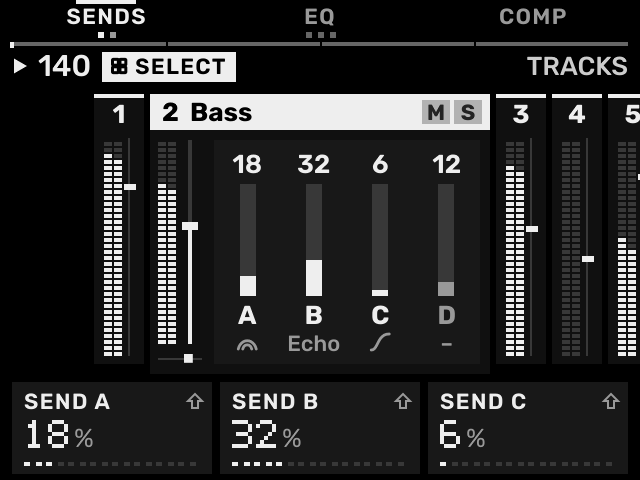

### Track levels and sends A–D

1. Press **PAD FX + KNOB FX** together to open **MIXER**. Turn the encoder or press the track's pad to select it. Use the **fader** for that channel's level. Hold **+** to open the selected-channel card; release it to keep that view. Hold **−** to return to all strips. Short + / − taps change parameter rows; they do not switch these views.
2. In BASIC, **B1 SENDS** offers **ENABLE FULL** for the advanced mixer. **B1 CANCEL** keeps BASIC; **B3 ENABLE FULL** changes the existing FEATURES setting without changing sounds or patterns.
3. In FULL, press **B1** until **SENDS** is selected. **K1 / K2 / K3** adjust this channel's sends **A / B / C** directly. Press **+** for the second row: **PAN / OUT / SEND D**; K3 adjusts D. Press **−** for A / B / C again. SHIFT temporarily shows the other row.
4. Press **PAD BANK** to show the other mixer channels. Select the labelled bus A–D and use the **fader** for its shared return level. Press PAD BANK again for the tracks.
5. **B1** switches SENDS and FX. **B2 EQ** and **B3 COMP** select the other mixer blocks in FULL. Turn NOTE REPEAT off to use those page buttons when its rate overlay is active.

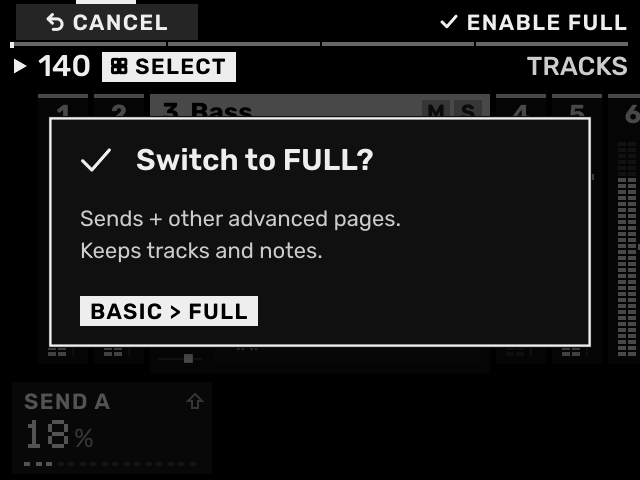

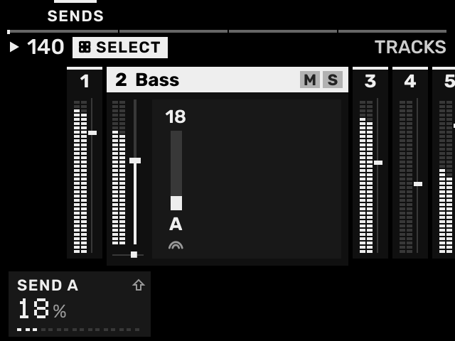

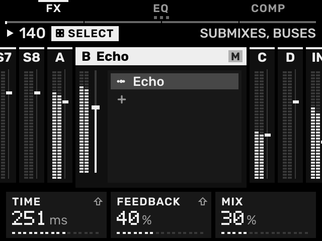

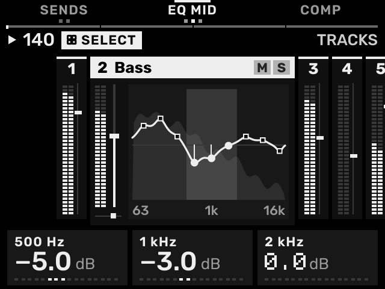

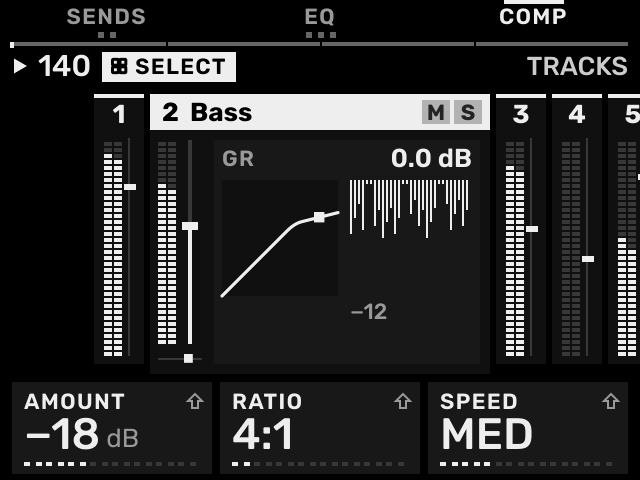

**SHIFT + encoder push** cancels the confirmation. In the Mixer itself, that gesture names a selected used track; press **SAMPLE** to return to its sound. **MENU → HERE → TRACK SETUP** opens instrument/type changes. Its BACK/SELECT buttons retain their own jobs while Note Repeat continues running.

| Control | Scope | Where |
| --- | --- | --- |
| Main engine CUTOFF / RESONANCE | The loaded instrument; whole kit for Rhythmer Kit | Plug-in PRESETS; linked to the corresponding EDIT controls |
| Pxx controls | One Rhythmer Kit pad | Sound EDIT after selecting the pad |
| Native sample FILTER | One sample pad | Sample track B3 FILTER |
| Native sample KIT FILT / SOUND filter | All pads of that native sample kit | Its SOUND / KIT FILT pages |
| DJ FILTER / ECHO / SPACE | Separate OS performance processing on the track | Plug-in B2 PERFORM |
| SEND A–D | Sends to shared buses | MIXER → B1 SENDS; BASIC offers FULL first. B1 also switches to FX |
| Engine FX / track inserts / bus FX | Different processing stages | Engine EDIT or the appropriate FX chain |

**ECHO is not simply SEND A and SPACE is not simply SEND B.** If effects sound excessive, reduce PERFORM ECHO/SPACE and track sends, then check the engine's own FX and inserts. Turning an effect input down does not erase an existing tail; double STOP cuts current audio.

MIXER uses the **fader** for level. In FULL SENDS, K1–K3 are A/B/C; the second row is PAN/OUT/D. The default black-and-white screen keeps colour names/metadata for kits without requiring colour to identify the selected track or pad.

## 14. Save, reopen and recover

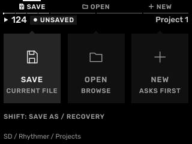

**SAVE keeps your project. Autosave keeps a separate recovery copy.** Autosave never overwrites your manually saved project and never creates numbered projects in your normal project folder.

### First SAVE: choose a folder and name

1. Stop playback and finish recording or printing.
2. Press **SHIFT + Pad 16**, release SHIFT, then press **B1 SAVE**. A folder browser opens.
3. Turn the encoder to choose a folder; push to enter it. **SHIFT + encoder push** goes up a folder. The header shows the current location.
4. Press **B3 USE FOLDER** to choose the displayed folder. **B2 NEW FOLDER** creates a folder there; enter that folder if you want to use it.
5. Enter the project name and press **B3 SAVE**. If that name already exists, **REPLACE** asks before overwriting it.
6. Wait for **SAVED**. A failed write leaves your previous project path and unsaved changes intact.

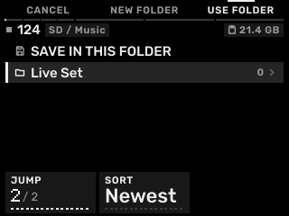

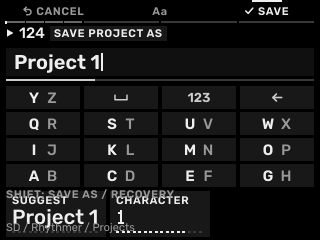

On a project with its own saved file, **B1 SAVE updates that same file** without asking for a folder each time. To choose a different folder or make a separate project, hold SHIFT and press **B1 SAVE AS** on the Project page. SAVE AS gives the new project its own recovery identity.

Save destinations are writable SD folders. INTERNAL, stock MPC project folders, system folders and Rhythmer's recovery/cache folders are not manual-save destinations. Selecting one does not silently save somewhere else. Back from the name sheet returns to folder selection; **B1 CANCEL** in the folder browser cancels the save.

### OPEN and NEW

Project → **B2 OPEN** → choose the project → push → LOAD. If the current project has changes, choose **SAVE**, **DISCARD** or **CANCEL**. SAVE must finish successfully before switching. DISCARD leaves the manually saved file unchanged; CANCEL keeps the current project open. NEW uses the same protection before offering a normal or empty new project.

### One recovery copy per project

After about three seconds without control input, while playback, recording, printing and loading are stopped, changed work is checkpointed under **Rhythmer/Autosave**. The same project updates the same recovery entry. Names do not determine identity, so two projects called Session can have separate recovery entries. A never-saved session also has one recovery entry; its first manual SAVE keeps that identity.

**UNSAVED** means changes have not been kept by your own SAVE. **Recovery saved HH:MM** only confirms a recovery checkpoint. These are different states.

On startup, an available last-work checkpoint offers **RECOVER** or **LATER**. To find it later: open the Project home tiles (**SAVE / OPEN / NEW**), then hold SHIFT and press **B3 RECOVERY**. Select the project recovery entry and LOAD. A recovered copy is unsaved; use SAVE, select a folder and name, and confirm any replacement before keeping it. Recovering does not overwrite your manual file. Discarded work is not automatically offered at the next startup, but its existing recovery entry remains available in RECOVERY.

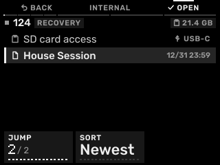

Recovery writing uses a temporary manifest and bounded staging for its loop/take/print data. Wait for work to finish before removing the card. Recovery is not a replacement for a separate SD backup.

| Save | Contains | Does not replace |
| --- | --- | --- |
| Project | Tracks, patterns, mix, supported modulation and instrument state | Backup of source audio / SD card |
| User Sound | The edited instrument sound | Project notes/arrangement |
| User Kit | Kit-wide and pad sound settings | Source sample backup or the project |

Back up **Rhythmer**, every manually chosen project folder, **Samples** and other original sample folders. Source samples remain referenced; saving a project does not collect every external sample into its destination. Existing numbered projects are left untouched.

## 15. Further tasks

These are separate tasks; do not use them as prerequisites for a first pattern.

| Goal | Entry and first action |
| --- | --- |
| Record input audio | In Full, choose Audio on an empty track, configure INPUT, then SEQ RECORD + PLAY for a pattern-length take |
| Auto-sample a plug-in or external MIDI instrument | On that Plugin/MIDI track outside Song, SHIFT + Pad 11 opens AUTO SAMPLE; allow its check to finish, set the key/note/sound rows with B2, then B3 SAMPLE |
| Separate a sample into stems | Native kit TRIM → SHIFT + B3 STEMS, or hold encoder → HERE → STEMS; use a source pad with four empty pads after it; completion places the parts as one undoable operation |
| Freeze a track | In Full, hold encoder → HERE → FREEZE; inspect the print options before starting. Deep freeze unloads the plug-in until thawed |
| Export MPC 3 | Song → B1 EXPORT → MPC 3. Export omits effects/sends/song tempo changes and non-WAV source samples; check it in MPC software |
| Use the USB web page | Connect USB-C networking and open rhythmer.local; its Files/guide/update pages are separate from audio plug-in editing |
| Mirror the screen over USB | Settings → SCREEN; enable screen mirror and choose MPC Sample as a camera in a camera application |

MIDI clock display is stabilised, but the clock-following algorithm is unchanged. For the first tutorial, disconnect external MIDI clock so you can set tempo locally.

## 16. When the result is not what you expected

| Symptom | Check first | Next action |
| --- | --- | --- |
| Pads change patterns, not sounds | Screen says PATTERNS / SEQUENCES, or SEQ is held | Release SEQ; press SAMPLE |
| No plug-ins listed | Installation and card folder | Use the full SD ZIP; plug-ins belong in Rhythmer/Plugins |
| Loaded a different track, but an old browser was visible | Header's selected track | Select the track again and press SAMPLE; instrument-owned browsers should follow the new track |
| Expected sound controls but see SLOT / SAVE / STATUS | Save tools are open | SHIFT + encoder push to return to sound EDIT |
| Kit knob changes the wrong sound | Selected P number | Hit the intended pad; check its Pxx label before turning the knob |
| Sound is quiet or silent | Track/pad level, main filter, mute and outputs | Try a known factory preset; open cutoff; check native/engine effects and MIDI input/port |
| Sound continues after STOP | Sustained notes/effect tails | Double STOP within 400 ms |
| Mixer soft keys show repeat rates | NOTE REPEAT / ARP | Turn that feature off. Hold encoder → HERE → TRACK SETUP changes track type. |
| Break is half/double speed | LOAD BARS | Reload using the source's actual bar count |
| LOOP variation or Grain does nothing | CHOP vs LOOP; Hold; STRETCH status | Use the conditions in the six-page table above |
| Save says error or a User preset is missing | Card space/write access; STATUS | Fix storage and save again. Do not assume the preset exists until READY |

## Credits

RHYTHMER OS is developed by jazzy rhythmer and built on Melodee by Kerem Kiliç (Ellic Studio), sample-base and the credited engine projects. Original licences and notices accompany the installation. This is an early beta. 
