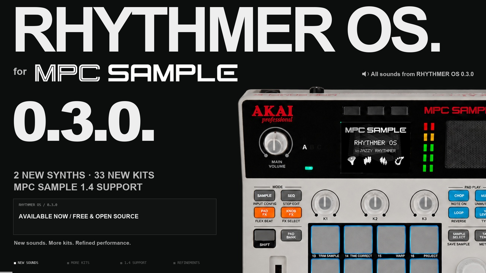

## RHYTHMER OS 0.3.0

**24 engine entries · 69 complete kits · MPC Sample 1.4 support.**

Amino adds wavetable synthesis with 324 original presets. Fizzik adds physical-modeling synthesis with 31 original presets. There are 33 new kits: 32 from Weird Dreams’ original banks and one 16-voice KrautDrums kit.

Break PERF held effects, A/B switching and Return are refined, alongside parameter groups, track switching, GEN/Acid/Break navigation and save/recovery fixes. Supports stock firmware **1.3.0.12, 1.4.0.7 and 1.4.0.8**; an official firmware update is not required.

Use the **full SD package** so the application, plug-ins and catalogue match. On stock 1.4, enable Developer Mode before a direct installation. If using a boot manager, preserve its launcher and follow its version-specific instructions.

[Download & installation](https://jazzyrhythmer.github.io/mpc-sample/installer/) · [Current manual](https://jazzyrhythmer.github.io/mpc-sample/manual/) · [Release files](https://github.com/JazzyRhythmer/mpc-sample-rhythmer-os/releases/tag/v0.3.0)

Early beta. Software checks have passed; physical-device installation of this release has not been verified.
