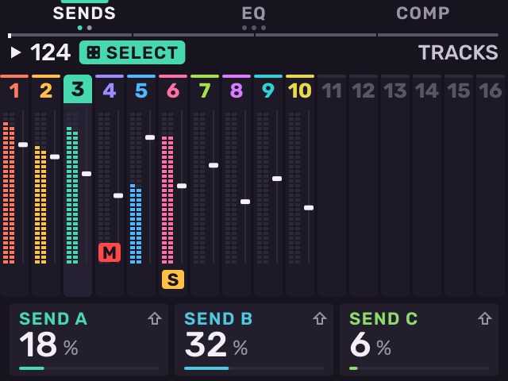
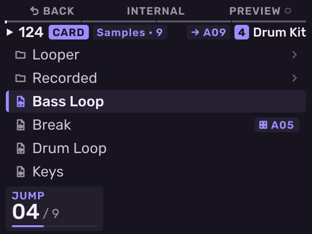
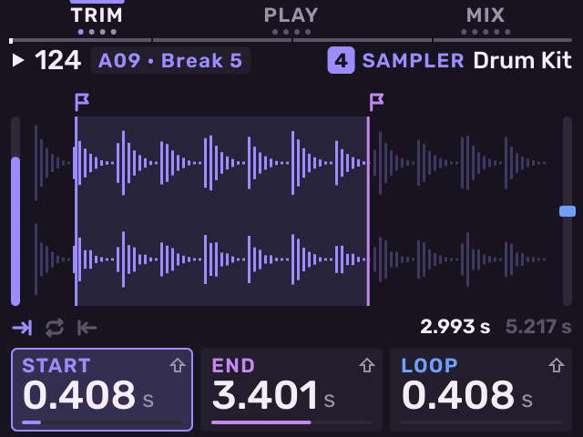
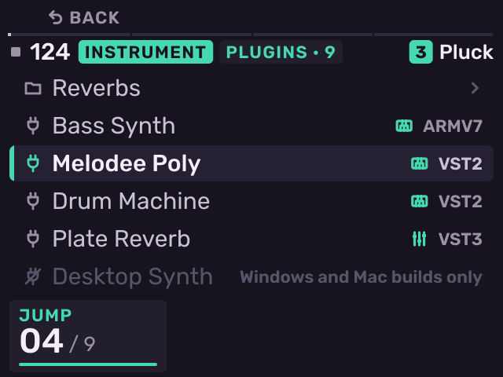
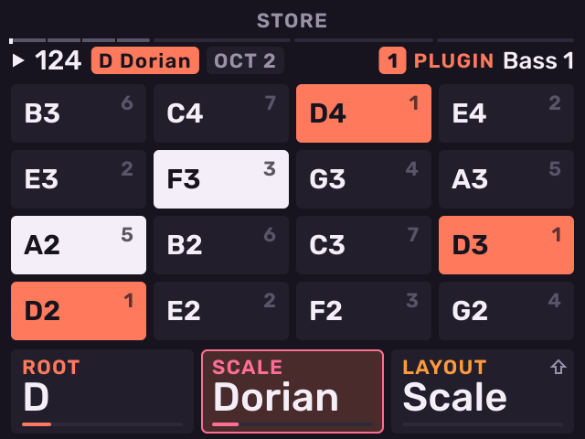
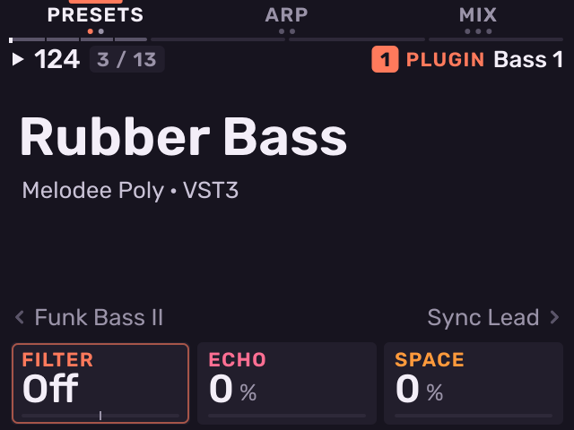
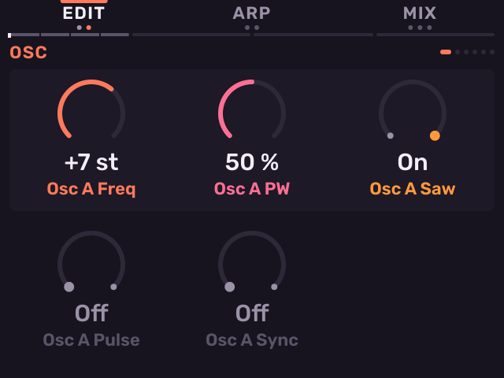
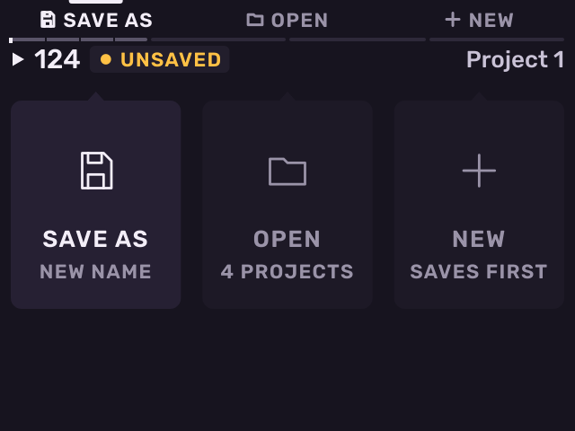
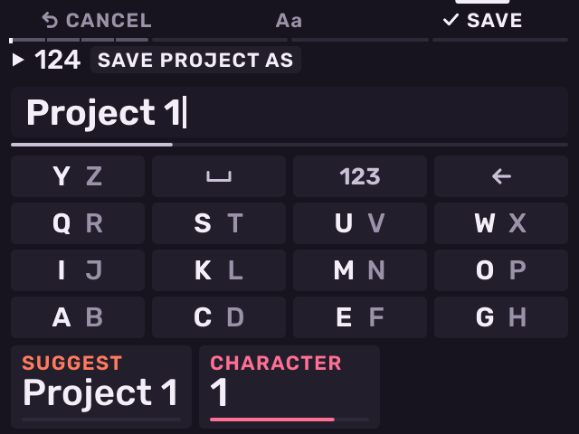
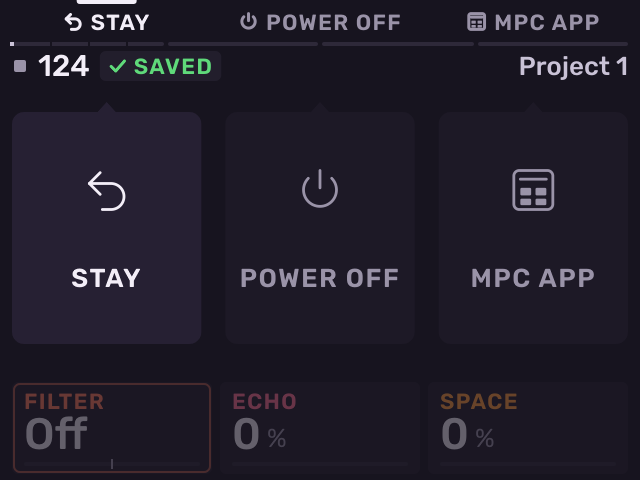

# Your first groove with RHYTHMER OS.

**Written for RHYTHMER OS 0.2.0.** This exercise builds a four-bar drum, bass and chord pattern, then saves it. Acid and Break are optional additions at the end. No downloaded break recording is required for the main exercise.

Use these written instructions for the current controls. The earlier First Groove video was made with an older interface; its labels and screen order are not the reference for 0.2.0.

## Before you start

- Install the **full SD ZIP**, including `Rhythmer/Plugins`, not only UPDATE.
- Connect headphones or speakers and start at a low output level.
- Disconnect external MIDI clock for this exercise so you can set tempo locally.
- **Push** = press the large encoder. **Turn** = rotate it. B1–B3 are the buttons above the screen; K1–K3 are the knobs below it.
- Back/cancel is **SHIFT + encoder push**. SHIFT + encoder turn is fine adjustment, not Back.

- An Akai MPC Sample with firmware **1.3.0.12**, **1.4.0.7** or
  **1.4.0.8**. On any other firmware Rhythmer does not start and the stock app keeps running.
- On firmware 1.4: **Developer Mode** on, in the stock app's Settings on
  the **DEV ENHANCEMENTS (BETA)** page.
- A microSD card.
- The release zip, `Rhythmer-MPC-Sample-<version>.zip`.

The zip holds the `autorun` folder and an `autorun.sh` file. The
`README.txt` and the licences are in `autorun/rhythmer/`.

1. Press **SHIFT + Pad 16** to open Project.
2. Press **B3 NEW**. On its confirmation, press **B2 EMPTY**.
3. Select track 1: hold **PAD BANK**, tap **pad 1**, then release PAD BANK.
4. Press **SAMPLE**. You should have an empty sample-kit track.

1. Back up the card. If it has an `autorun` folder at its top level, move
   that folder somewhere safe. Rhythmer's `autorun` folder replaces it.
2. Unzip the release and copy the `autorun` folder and `autorun.sh` to
   the top level of the card. The card now has `autorun.sh`,
   `autorun/autorun.sh` and `autorun/rhythmer/`. Do not edit or rename
   anything inside them: the MPC does not start an autorun whose files
   have changed.
3. Optional: to use plug-ins, make a folder named `Plugins` inside the
   `Rhythmer` folder on the card (`Rhythmer/Plugins`) and copy your plug-ins
   into it. A plug-in's release zip can go in as it is: Rhythmer unzips it
   the next time the plug-in picker opens. See
   [Plug-ins](guide/plug-ins.md) for what runs.
4. Put the card in the MPC and switch it on. The stock app starts first.
   On firmware 1.4 it asks whether to run the card's autorun script: press
   Yes. A few seconds later Rhythmer starts, with a new project open on
   track 1.

Rhythmer changes nothing on the MPC itself. To stop it from starting, delete
the `autorun` folder and `autorun.sh` from the card.

1. Press **PAD FX + KNOB FX together** to open TRACKS.
2. Press **B1 TRACK SETUP**, select **TRACK TYPE**, then **PLUG-IN**.
3. Choose **Rhythmer Kit** from the top of the plug-in list and push to load it.
4. Press **SAMPLE**, then B1 until **PRESETS** is selected.
5. Push to open the preset list, choose **DRUM-X**, then push / **B3 LOAD**.
6. Return to SAMPLE and use bank A. If necessary, tap PAD BANK until bank A is selected.
7. Play **pad 1 = kick**, **pad 2 = snare**, **pad 4 = closed hat**.

**Check:** each of those pads plays a different drum. If the list is empty, check the full installation and `Rhythmer/Plugins` before continuing. If every pad changes the pitch of one sound, check that the loaded engine is Rhythmer Kit rather than an individual drum sound.

## 3. Set tempo and the drum pattern length

1. Hold **TAP TEMPO** and turn the encoder to **140 BPM**, then release it.
2. Press **SEQ**. If an editor opens, press B1 for SEQUENCES; press B1 again for **PATTERNS**.
3. Select **bank A, pad 1** for pattern 1.
4. On the pattern settings row, set **K1 LENGTH = 4 bars**, **K2 Q = 1/16**, **K3 SWING = 50%**.
5. Press **SAMPLE** before playing notes.

**Check:** the header still identifies track 1. The pads now play drums. On PATTERNS they select patterns instead. Pattern length belongs to this track; you will set it separately for tracks 2 and 3.

## 4. Record drums

1. Enable a count-in if useful: **SHIFT + Pad 4** toggles it.
2. Press **SEQ RECORD**, then **PLAY**. Wait for the count-in if enabled.
3. Count **1, 2, 3, 4** in each bar. Tap kick **pad 1** on beats **1 and 3** for four bars.
4. Let the pattern loop. Add snare **pad 2** on beats **2 and 4**.
5. Let it loop again. Add closed hat **pad 4** on the counts **1-and-2-and-3-and-4-and**.
6. Press **SEQ RECORD** again to leave recording while playback continues. Press STOP when you want to stop.

| Control | Action |
| --- | --- |
| **B1**, **B2**, **B3** | Select the page or action named above each key. |
| **K1**, **K2**, **K3** | Set the value on the card above each knob. |
| Encoder (turn) | Move through a list, or fine-tune the outlined card. |
| Encoder (push) | Open the item under the cursor, or move to the next card. |
| Encoder (hold) | Open the **Menu**: the page's jobs (**HERE**) and the 16 places (**GO**). |
| **SHIFT** + encoder push | Go back one page. |
| **SHIFT** + **−** / **+** | Undo / redo. |

Rhythmer starts on **Full**, which shows every page. **Basic** shows the
stock app's pages plus tracks, plug-ins, the mixer and Song. To switch, press
**SHIFT** + **Pad 8** (Settings) and turn **K1** (**FEATURES**). See
[Basic and Full](guide/settings.md#basic-and-full).

Rhythmer has four short lessons. Hold the encoder, press **B3** (**GO**),
then pad 16 (**LEARN**). See [Lessons](guide/basics.md#lessons).

## 3. Select a track

Rhythmer has 16 tracks, one for each pad. Pad 1 (bottom left) is track 1.

To select a track, hold **PAD BANK** and press a pad. This works on any
page.

A new project has no tracks. It opens on track 1 with the track types, so
you choose what it is first ([step 4](#4-load-samples-into-a-kit) makes it a
kit). The other tracks stay empty until you choose what they are (see
[step 7](#7-add-a-plug-in-instrument)).

To mix the tracks, press **PAD FX** and **KNOB FX** together to open the
mixer. Every track is a strip; the selected one is lit. Hold **+** to see
its card (its sends, EQ or compressor), hold **−** to go back to the
strips. Press a pad or turn the encoder to pick a track. The
fader sets its level, **K1**–**K3** its sends A–C. Press **B2** for its EQ
and **B3** for its compressor (see
[The mixer](guide/mixer-and-effects.md#the-mixer)).

## 4. Load samples into a kit

Rhythmer reads WAV (16, 24 or 32-bit), MP3, FLAC, Ogg Vorbis and AIFF files (any sample rate;
a WAV up to 6 hours) from `Rhythmer/Samples` on the card, or anywhere else on it. It can
also read the MPC's internal factory samples.

1. Select track 1 (hold **PAD BANK**, press pad 1). In a new project it
   shows the track types.
2. Turn the encoder to **Drum** and push it, then push it on **Card**.
   Track 1 is now a kit, and the sample browser opens. On a track that is already a
   kit, press **SAMPLE SELECT** to open the browser.
3. Turn the encoder to move through the list. Push the encoder to open a
   folder. Press **B1** to go back out of a folder.
4. Press **B2** to switch between the card (**CARD**) and the MPC's
   factory samples (**INTERNAL**).
5. Press **B3** to turn on **PREVIEW**. Each file plays when you move to it.
   **PREVIEW** stays on until you turn it off.
6. Hit the pad you want to load onto, then push the encoder on a file. The
   file loads onto the last pad you hit.

To load a file onto the next empty pad, hold **SHIFT** and press any pad.

The browser also loads SFZ, MPC programs and expansions, EXS24, SoundFont
and DecentSampler instruments onto a pad. See
[Sampled instruments](guide/kits-and-sampling.md#sampled-instruments).
Push on an MPC kit to open **LOAD KIT**: it loads the whole kit, or only the
banks you pick. See [Loading samples](guide/kits-and-sampling.md#loading-samples).

## 5. Edit a pad

Press **SAMPLE** to open **Stage**. Stage holds the quick pages of the
selected track. On a kit, these are the stock Sample mode pages for the last
pad you hit.

- **B1** cycles **TRIM**, **LAYERS**, **TUNE** and **AMP ENV** (on a sampled
  instrument: **ZONES**, **TUNE** and **AMP ENV**).
- **B2** cycles **PLAY**, **COLOUR**, **FOLLOW** and **CLOUD**.
- **B3** cycles **MIX**, **SENDS**, **FILTER**, **FILT ENV** and **KIT FILT**.

Press the lit key again to go to its next page. The dots under a key show
which page of its cycle is open.

## 5. Load and record a bass on track 2

1. Hold **PAD BANK**, tap **pad 2**, release PAD BANK. Check **track 2** in the header.
2. The empty-track type cards appear. Choose **Plugin**, then **FMini-1**. If another screen remains open, press SAMPLE first.
3. On PRESETS, push for the list. Select **MOOG BASS**, then push / LOAD.
4. Hold **SAMPLE** for Keys. Set **K1 ROOT = C**, **K2 SCALE = Minor**, **K3 LAYOUT = Scale**, then release SAMPLE.
5. Press SEQ → B1 until PATTERNS, choose pattern 1, and set **4 bars / 1/16 / 50%** as on track 1.
6. Press SAMPLE. Try pads **1, 3 and 5**. Use −/+ to move the playable octave if needed.
7. Press SEQ RECORD → PLAY and record a short phrase with those pads. Leave space between notes. Press SEQ RECORD again to stop recording.

**Check:** drums still play from track 1; pads now play bass on track 2. A pad changes the bass note, not its preset. Selecting a track alone does not make PATTERNS pads become musical notes: SAMPLE does.

## 6. Add chords on track 3

1. Press **SEQ** to open **Sequences**. If Patterns, Roll or Motion opens
   instead, press **B1** (**SEQUENCES**). The bank's 16 sequences are laid out as
   the pads: pad 1 bottom left. A sequence keeps one pattern for each
   track.
2. Hold **SEQ** and use **K1** to set the pattern length in bars and **K2**
   the grid (Q) of the selected track's pattern. **K3** sets the swing of
   the project.
3. To change to another sequence, press its pad. Pad 1 is sequence 1. Every
   track goes to the pattern that sequence keeps. A new sequence keeps
   nothing: the tracks play on until you launch a pattern. On other pages,
   hold **SEQ** and press **SHIFT** + a pad.

**Check:** the displayed preset name is A11 Brass. This is the original brass preset, not a newly authored replacement or a patch described as a pad sound.

   To put one track on another pattern, press **B1** again for
   **Patterns**. Its pads are the selected track's patterns. On any page,
   hold **SEQ** and press a pad for the same. The sequence you are on keeps
   the pattern you launch.

1. Press PAD FX + KNOB FX together for **TRACKS**.
2. Select track 1, 2 or 3 using the encoder or PAD BANK + its pad.
3. Use **K1 LEVEL** to balance it, **K2 PAN** for left/right position and **K3 SEND A** only if you intend to use bus A.
4. To adjust the whole drum kit's filter: select track 1 → SAMPLE → B1 PRESETS → **KIT CUTOFF / KIT RESONANCE**.
5. To adjust only one drum's volume: track 1 → SAMPLE → B1 EDIT → hit that pad → first row **K1 Pxx Volume**. Check the P number before turning it.

**Check:** KIT CUTOFF affects all kit pads; Pxx Volume affects only the selected pad. ECHO/SPACE on PERFORM are separate track effects, not the main engine filter or sends A/B.

## 8. Save and reopen

1. Press STOP and finish recording or printing.
2. Press **SHIFT + Pad 16**, release SHIFT, then press **B1 SAVE**. For this first save, choose a folder with the encoder: push enters it, SHIFT + encoder push goes up.
3. Press **B3 USE FOLDER**, enter **FIRST GROOVE 020**, then press **B3 SAVE**.
4. Wait for **SAVED**. Keep the original samples and plug-in folders on the card. Future B1 SAVE presses update this file; Project → **SHIFT + B1 SAVE AS** chooses another folder/name for a separate project.
5. To reopen: Project → **B2 OPEN** → choose the project → push → LOAD. With unsaved changes, choose SAVE, DISCARD or CANCEL.

Automatic recovery is separate: it updates one entry for this project under Rhythmer/Autosave, without overwriting your manual save. From the Project home tiles (SAVE / OPEN / NEW), **SHIFT + B3 RECOVERY** opens the recovery list. Use SAVE after loading a recovered copy to keep it deliberately.

- **SHIFT** + **Pad 4**: turn the one-bar count-in on or off.
- **SHIFT** + **Pad 10**: turn **Rec Quantize** on or off. It is on at
  first: recorded notes land on the pattern's Q.
- **SHIFT** + **TAP TEMPO**: set the metronome to Off, On or Rec.

## Optional: generate an Acid line on track 4

1. Select track 4 → Plugin → **Acid Engine** → preset **SQUELCH**.
2. Select pattern 1 and set the desired pattern length.
3. Open **SEQ → B1 PATTERNS → SHIFT + B3 GEN**.
4. Select **ACID GEN**, not GENERATE SONG.
5. Start with **DENSITY 70 / ACCENT 40 / SLIDE 25**. On settings page 2 keep **AUTO MUTATE off** for now.
6. Choose GENERATE ACID and push / APPLY. Press PLAY to compare it with the other tracks.
7. Back returns to GEN; another Back returns to PATTERNS. SHIFT + − undoes a generation operation.

**Do not apply GENERATE SONG to tracks 1–4 here.** SOUND + MIDI can replace the instruments and patterns you just recorded. ACID GEN and GENERATE T4 work on the selected track instead.

## Optional: add your own Break loop on track 5

1. Hold **PAD BANK** and press pad 2 to select track 2.
2. The track is empty, so Stage opens with the track types, as on the MPC:
   **Drum** (an empty kit, samples from the card, or a recording),
   **Keygroup** (an instrument played across the keys), **Plugin** (a
   plug-in instrument), **MIDI** (an external instrument on the MIDI Out
   jack or USB) and **Audio** (a recording of the input).

If it plays at half/double the intended speed, check the source's bar count. Changing Grain knobs alone does not trigger stretching: hold pad 3 STRETCH on page 2, keep it held and turn to page 5. LOOP VARIATIONS requires LOOP mode, playback and PATTERN HOLD off. See the [Break instructions](guide/MANUAL_020_EN.md#12-load-a-break-and-return-to-its-controls) before using those pages.

## If you get stuck

   

5. Press **SAMPLE** to open Stage, and play the pads. To set the key and
   scale the pads play in, hold **SAMPLE** to see **Keys** and turn **K1**
   for the root, **K2** for the scale and **K3** for the pad layout. Press
   **−** / **+** to change the octave.

   

6. Press **SAMPLE** again for **PRESETS**, the first page of **B1**. Turn
   the encoder to step through the plug-in's presets, or push it for the
   whole list. **K1**–**K3** are **FILTER**, **ECHO** and **SPACE** on
   every plug-in.

   

7. Press **B1** for **EDIT**, its next page: the plug-in's own parameters
   come on **K1**–**K3**, in rows of three. Turn the encoder to move through
   the rows, and press **−** / **+** for the plug-in's page before or after.

   

Record the plug-in track the same way as the kit in
[step 6](#6-record-a-beat).

## 8. Save the project

Rhythmer saves the project by itself, three seconds after you last used a
control while nothing plays. A new project is saved as **Project 1**,
**Project 2** and so on. To give it a name of its own:

1. Press **SHIFT** + **Pad 16** to open **Project**.
2. Press **B1** (**SAVE AS**).

Rhythmer asks for a name. The pads type like phone
keys: each pad shows the letter it types next. Pad 14 types a space, pad 15
switches to digits and pad 16 deletes. Turn the encoder to move the cursor.
Press **B3** (**SAVE**) or push the encoder to save. Press **B1** to cancel.

Projects are saved in `Rhythmer/Projects` on the card. To open another
project, press **B2** (**OPEN**) on the Project page.

## 9. Exit Rhythmer

Press **POWER** briefly. The Exit screen opens:

- **B1** (**STAY**): go back to Rhythmer.
- **B2** (**POWER OFF**): save the project and switch the MPC off.
- **B3** (**MPC APP**): save the project and go back to the stock app until
  the next time the MPC is switched on.

The [full manual](guide/MANUAL_020_EN.md) explains instrument replacement, User Sound/Kit saving and the six Break pages. Use the [button reference](guide/QUICK_REFERENCE_020_EN.md) to distinguish selecting a track, opening its instrument and choosing its pattern.

Based on Melodee by Kerem Kiliç (Ellic Studio), sample-base and credited engine projects.
