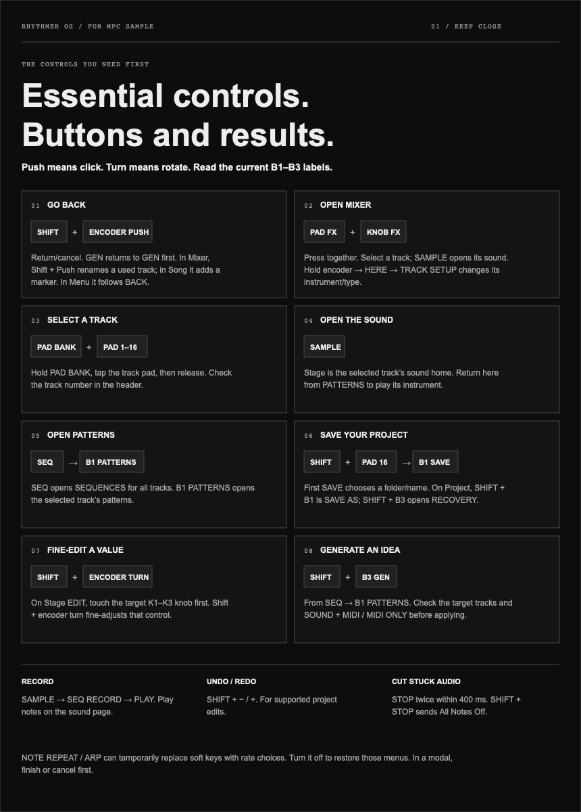

# RHYTHMER OS 0.3.0 — Essential controls

**PUSH = press the large encoder. TURN = rotate it.** B1–B3 are the three screen buttons; K1–K3 are the knobs below the screen. Use the currently displayed labels.

| Do this | Controls | Check afterwards |
| --- | --- | --- |
| Back / cancel | SHIFT + encoder **push** | Most pages: one level back. MENU/dialog: cancel. Mixer and Song have native exceptions below. |
| Fine-adjust | Touch K1–K3, then SHIFT + encoder **turn** | The last touched knob's value changes. This is not Back. |
| Open MIXER | PAD FX + KNOB FX together | Select/mix tracks; MENU → HERE → TRACK SETUP changes instrument/type |
| Select track 1–16 | Hold PAD BANK, tap its pad, release | Header's track number changes |
| Mix sends A–D | MIXER → B1 SENDS | BASIC offers ENABLE FULL. FULL: K1–K3 A/B/C; + gives PAN/OUT/D |
| Rhythmer Kit pad mute | SAMPLE → MUTE → pad | Drums layout, 16 Levels off; tap MUTE again to leave mute mode. SHIFT + pad solos; SHIFT + MUTE clears all project mutes/solos |
| Play notes / drums | SAMPLE | Pads play the selected instrument |
| Choose a pattern on one track | SEQ → B1 until PATTERNS | Pads choose that track's patterns |
| Launch across tracks | SEQ → B1 until SEQUENCES | Pads launch a sequence number across tracks |
| Open Step Edit | SHIFT + SEQ | Step editor for the selected track/pattern |
| Record | SAMPLE → SEQ RECORD → PLAY | Wait for count-in, play notes; SEQ RECORD again leaves recording |
| Generate | PATTERNS → SHIFT + B3 GEN | Check target and NEW SOUNDS / KEEP SOUND(S) before APPLY |
| Save a project | SHIFT + Pad 16, release SHIFT → B1 SAVE | First save: folder → B3 USE FOLDER → name → B3 SAVE; later saves update that file |
| Save another copy | Project → SHIFT + B1 SAVE AS | Choose a folder and name; original project stays |
| Recover work | Project → SHIFT + B3 RECOVERY | One recovery entry per project; use SAVE after loading it |
| Undo / redo | SHIFT + − / + | Supported project edit is restored/reapplied |
| Cut current audio | STOP twice within 400 ms | Current notes/tails stop; a new note or PLAY resumes |
| Open settings | SHIFT + Pad 8 | Main Settings; K1 FEATURES selects Basic/Full |

A single PAD BANK tap changes the pad bank; a held track-selection gesture does not. NOTE REPEAT/ARP can replace soft keys with repeat rates. Modal screens must be finished or cancelled before returning to the underlying page.

[Full instructions](MANUAL_020_EN.md) · [First Groove](FIRST_GROOVE_020_EN.md) · [System map](SYSTEM_MAP_020_EN.md)

In **MIXER**, SHIFT + encoder push names the selected used track; **SAMPLE** returns to its sound. In **SONG**, SHIFT + encoder push adds/edits a marker. In **MENU**, SHIFT + encoder push closes MENU without selecting anything. In the project file browser it first moves up a folder. Use the page’s displayed CANCEL to leave an entire save operation.
